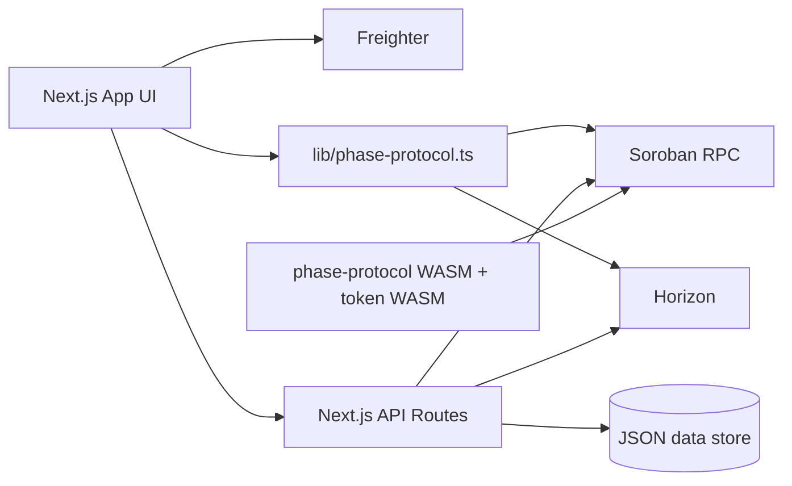

# PHASE Project Architecture

This document defines the architecture baseline for PHASE and is the primary reference for implementation decisions, reviews, and refactors.

## 1) Scope and intent

PHASE is a testnet system composed of:

- **Client application** (Next.js) for forge, dashboard, and chamber UX.
- **API layer** (Next.js route handlers) for reward distribution, trustline relay, x402 support, and profile/listing persistence.
- **On-chain contracts** (Soroban) for protocol state and token interactions.
- **Wallet signing boundary** (Freighter) for user-authorized transactions.

The architecture is designed to keep signing on the client while keeping privileged operations on the server.

## 2) High-level component map

## 3) Runtime boundaries

### 3.1 Client boundary

Owns:

- Wallet connection and signature prompts.
- Interactive state, tactical UI, i18n rendering.
- Read-only on-chain queries (when safe via SDK simulation helpers).

Must not own:

- Admin secrets.
- Issuer secret for classic bootstrap.
- Persistent trusted state decisions.

### 3.2 Server boundary

Owns:

- Reward minting with admin credentials.
- Trustline submit relay endpoint (for signed XDR).
- Persistent JSON data (`faucet claims`, `artist profile`, `listings`) through `lib/server-data-paths.ts`.
- x402 endpoints and payment verification support.

Must not own:

- User private keys.

### 3.3 On-chain boundary

Owns:

- Canonical protocol state (`collection`, `phase`, utility-NFT ownership, settlement effects).
- Token balances and transfer semantics according to deployed contracts.

## 4) Principal user flows

### 4.1 Forge flow

1. User connects wallet.
2. Optional trustline bootstrap is established where applicable.
3. User submits collection metadata and price.
4. Client builds Soroban tx and asks Freighter signature.
5. Tx is sent and confirmed; collection ID is resolved.

### 4.2 Chamber settlement flow

1. Client fetches wallet state and collection price.
2. User executes settlement action.
3. Client signs and submits transaction.
4. On success, chamber refreshes artifact and ownership state.

### 4.3 Rewards flow

1. Client queries `/api/faucet` status.
2. If classic trustline is required, user signs `changeTrust`.
3. Client submits signed trustline to `/api/classic-liq/trustline`.
4. Client calls reward claim endpoint (`/api/faucet` or compatibility route).
5. Server mints reward when conditions are met.

## 5) API architecture principles

- **Typed contracts** for request/response payloads in route handlers.
- **Deterministic status codes** (validation, cooldown, authorization, pending).
- **No implicit success**: all state transitions explicit and auditable.
- **Compatibility routes** allowed if typed and documented.

## 6) Internationalization architecture

- UI strings belong to `lib/phase-copy.ts`.
- Components consume text via `pickCopy(lang)` and must avoid hardcoded user-facing literals.
- New features require EN/ES keys before merge.

## 7) Error-handling architecture

- Domain-level error normalization is required before UI messaging.
- Unauthorized on-chain gate errors (`#13`) map to narrative tactical message:
  - `[ ERROR: BIOMETRIC_TRUST_GATE_CLOSED ]`
- User-facing failures should remain actionable and non-ambiguous.

## 8) Performance architecture (UI)

- Tactical animation classes use GPU compositing hints where flicker/pulse is intentional.
- Keep animations isolated to key controls; avoid broad repaint cascades.
- Prefer CSS primitives and avoid JS-driven animation loops unless required for state logic.

## 9) Security architecture

- Secrets only in server runtime configuration.
- `.env.local` and sensitive keys are never committed.
- Testnet-only assumptions must be explicit in docs and code comments.
- Any privileged operation must validate input shape and origin intent.

## 10) Feature flags (rolling delivery)

| Flag | Env | Purpose | Default | Rollback |
|------|-----|---------|---------|----------|
| `phase-121` | `NEXT_PUBLIC_FEATURE_PHASE_121` / `FEATURE_PHASE_121` | Gateway health dashboard with latency scoring | off | Unset var, restart — dashboard returns 404, protocol falls back to static gateway list |
| `phase-122` | `NEXT_PUBLIC_FEATURE_PHASE_122` / `FEATURE_PHASE_122` | Off-chain metadata delta storage (reduce on-chain rent) | off | Unset var, restart — verify falls back to on-chain `token_uri`, off-chain files remain on disk (no ledger revert) |
| `phase-123` | `NEXT_PUBLIC_FEATURE_PHASE_123` / `FEATURE_PHASE_123` | IPFS timeout fallback chain across providers | off | Unset var, restart — reverts to 8s sequential fallback; no data migration |
| `phase-124` | `NEXT_PUBLIC_FEATURE_PHASE_124` / `FEATURE_PHASE_124` | Metadata version migration tool (v1→v2) | off | Unset var, restart — v2 payloads remain readable as v1 where additive; no destructive rewrite without `--apply` |
| `phase-167` | `NEXT_PUBLIC_FEATURE_PHASE_167` / `FEATURE_PHASE_167` | WalletConnect session resilience: relay failover, chain guard, deep-link return, closed `session_restored` counter (Spike 623) | off | Unset var, restart — default wallet-kit behavior; localStorage session metadata is ignored, no migration |
| `phase-182` | `NEXT_PUBLIC_FEATURE_PHASE_182` / `FEATURE_PHASE_182` | Classic PHASELQ/XLM pools + Soroswap router adapter, quote-hash/min-out idempotency, router drift fails closed (Spike 574) | off | Unset var, restart — `/api/liquidity-pools` returns 404; `liquidity-pool-intents.json` and `pool-activity.json` stay inert |
| `phase-220` | `NEXT_PUBLIC_FEATURE_PHASE_220` / `FEATURE_PHASE_220` | Stellar Expert deep links + read-only tx/asset enrichment with timeout and fallback (Spike 648) | off | Unset var, restart — enrichment endpoint returns 404 and component renders raw hashes only; mainnet links fenced by default |
| `phase-221` | `NEXT_PUBLIC_FEATURE_PHASE_221` / `FEATURE_PHASE_221` | Albedo sunset: call-site registry, parity-freeze with pinned intent 0.12.0, retired mode fails closed with migration copy (Spike 626) | off | Unset var, restart — banner hidden, legacy guarded Albedo paths restored |

Flags are read via `lib/feature-flags.ts:isFeatureEnabled`. Client flags use `NEXT_PUBLIC_*`, server also accepts `FEATURE_*`. Zero regression when off.

## 11) Change-management rules

- Architectural changes require updates to:
  - `PROJECT_ARCHITECTURE.md` (this file)
  - `docs/TECHNICAL.md`
  - relevant API docs
- Contract/address changes require synchronized env and docs updates.
- Flag-gated features must document rollback in this table and in `docs/TECHNICAL.md` § Feature Flags.

## 12) Gated integration boundaries (phase-167 / 182 / 220 / 221)

- **Explorer (phase-220)**: `lib/explorer-links.ts` builds allow-listed Stellar Expert URLs (testnet default; mainnet fenced) and performs read-only Horizon enrichment with a hard timeout. The request contract accepts only `kind` + `id`; wallet/email/memo fields are rejected before any fetch. Failed enrichment degrades to the raw hash.
- **Pools (phase-182)**: quote and XDR preparation happen server-side but **signing stays client-side** via `signTransaction`. There is no default Soroswap router: drift between configured and pinned router IDs fails closed before a transaction is built. Quote hash + min-out + short TTL are the idempotency contract; double submits replay, stale/slippage returns 409. Pool seed capital is subtracted from available balance and self-provisioned/self-swap activity is excluded from volume.
- **WalletConnect (phase-167)**: relay candidates, chain guard, session persistence and deep-link return live in `lib/walletconnect-resilience.ts`. Wrong-chain sessions are rejected before use; return paths must be same-origin relative. Telemetry uses a closed counter set (`session_restored`, `relay_failover`, `deep_link_return`).
- **Albedo sunset (phase-221)**: every Albedo call site is registered and gated through `lib/albedo-sunset.ts`; `retired` mode blocks signing before the intent bundle loads and surfaces migration copy. `@albedo-link/intent` remains pinned at 0.12.0; new call sites are rejected while the program is active.
