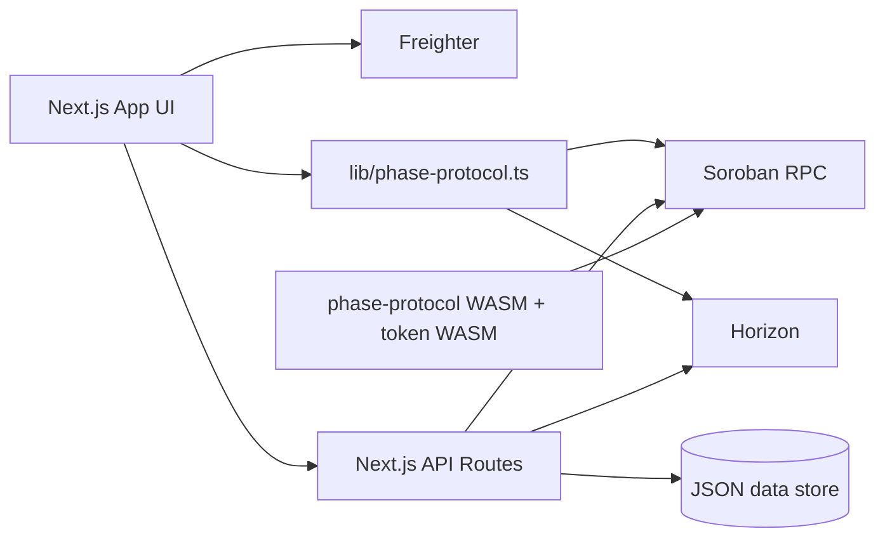

# PHASE Project Architecture

This document defines the architecture baseline for PHASE and is the primary reference for implementation decisions, reviews, and refactors.

## 1) Scope and intent

PHASE is a testnet system composed of:

- **Client application** (Next.js) for forge, dashboard, and chamber UX.
- **API layer** (Next.js route handlers) for reward distribution, trustline relay, x402 support, and profile/listing persistence.
- **On-chain contracts** (Soroban) for protocol state and token interactions.
- **Wallet signing boundary** (Freighter) for user-authorized transactions.

The architecture is designed to keep signing on the client while keeping privileged operations on the server.

## 2) High-level component map

## 3) Runtime boundaries

### 3.1 Client boundary

Owns:

- Wallet connection and signature prompts.
- Interactive state, tactical UI, i18n rendering.
- Read-only on-chain queries (when safe via SDK simulation helpers).

Must not own:

- Admin secrets.
- Issuer secret for classic bootstrap.
- Persistent trusted state decisions.

### 3.2 Server boundary

Owns:

- Reward minting with admin credentials.
- Trustline submit relay endpoint (for signed XDR).
- Persistent JSON data (`faucet claims`, `artist profile`, `listings`) through `lib/server-data-paths.ts`.
- Signals, replies, edit history and reactions live in SQLite (`lib/sqlite-db.ts`, WAL mode), not the JSON sidecar.
- x402 endpoints and payment verification support.
- Concurrency safety for the signal store: version-guarded writes (`WHERE id = ? AND version = ?`) with bounded retry, plus `BEGIN IMMEDIATE` transactions for parent-version checks. Holds across processes, so concurrent Vercel instances no longer interleave. See `docs/TECHNICAL.md` 5.3.
- Collaborative signal lore drafting (phase-141, issue #207): a Yjs CRDT draft in SQLite (`signal_crdt_docs` / `signal_crdt_updates`) that merges concurrent edits automatically and never writes the `signals` row. The merged draft is promoted to committed lore only through `PUT /api/signals/[id]` with `from_draft: true`, which reuses the same `If-Match` CAS and `signal_versions` snapshot as a manual edit. Sync is HTTP state-vector exchange, not WebSocket, because the app deploys to Vercel serverless. See `docs/TECHNICAL.md` 5.3.
- AI agents (phase-142 curator, phase-143 pricing oracle, phase-146 moderation triage, phase-147 quest arcs). All four keep the decision deterministic and testable — selection/hang order, price and band, triage thresholds, step catalog and reward sizing — and use the model (`generateJsonStep` in `lib/forge/ai-pipeline.ts`) only for prose or category scores, which are validated against ids the server already holds and replaced by `pickCopy` templates when they fail. State lives in version-guarded SQLite rows (`exhibitions`, `price_suggestions`, `moderation_queue`, `quest_arcs`). Operator routes fail closed when `PHASE_ADMIN_KEY` is unset (`lib/admin-key.ts`). See `docs/TECHNICAL.md` §14 and `docs/spikes/142…147-*.md`.
- Other JSON-backed stores (`follow`, `profile`, `market`, `notification`, `achievement`, `narrative-world`) still do unguarded read-modify-write on their sidecar files. Single-writer is safe; concurrent writers lose updates.

Must not own:

- User private keys.

### 3.3 On-chain boundary

Owns:

- Canonical protocol state (`collection`, `phase`, utility-NFT ownership, settlement effects).
- Token balances and transfer semantics according to deployed contracts.

## 4) Principal user flows

### 4.1 Forge flow

1. User connects wallet.
2. Optional trustline bootstrap is established where applicable.
3. User submits collection metadata and price.
4. Client builds Soroban tx and asks Freighter signature.
5. Tx is sent and confirmed; collection ID is resolved.

### 4.2 Chamber settlement flow

1. Client fetches wallet state and collection price.
2. User executes settlement action.
3. Client signs and submits transaction.
4. On success, chamber refreshes artifact and ownership state.

### 4.3 Rewards flow

1. Client queries `/api/faucet` status.
2. If classic trustline is required, user signs `changeTrust`.
3. Client submits signed trustline to `/api/classic-liq/trustline`.
4. Client calls reward claim endpoint (`/api/faucet` or compatibility route).
5. Server mints reward when conditions are met.

## 5) API architecture principles

- **Typed contracts** for request/response payloads in route handlers.
- **Deterministic status codes** (validation, cooldown, authorization, pending).
- **No implicit success**: all state transitions explicit and auditable.
- **Compatibility routes** allowed if typed and documented.
- **Optimistic concurrency on shared mutable records**: a record that more than one
  client can edit carries an integer `version`. Reads publish it as an `ETag`;
  mutations may echo it back as `If-Match` (or `parent_version` for appends) and
  the server rejects a stale value with `409` rather than silently overwriting a
  concurrent writer. `409` is logged under the `signals.version_conflict` event
  and counted in `signal_version_conflicts` so conflict rates are observable.
- **Optimistic concurrency guards commits, it does not refuse collaboration.**
  Where many people edit one record at once, `409` on every save is a correct
  answer to the wrong question. Signals therefore layer a CRDT *draft* over the
  guarded record: concurrent proposals merge automatically, and the merged
  result is promoted through the same `If-Match` guard so the authoritative row
  keeps a single linear history. The guard is never removed; it moves to the one
  place a decision actually has to be made.

## 6) Internationalization architecture

- UI strings belong to `lib/phase-copy.ts`.
- Components consume text via `pickCopy(lang)` and must avoid hardcoded user-facing literals.
- New features require EN/ES keys before merge.

## 7) Error-handling architecture

- Domain-level error normalization is required before UI messaging.
- Unauthorized on-chain gate errors (`#13`) map to narrative tactical message:
  - `[ ERROR: BIOMETRIC_TRUST_GATE_CLOSED ]`
- User-facing failures should remain actionable and non-ambiguous.

## 8) Performance architecture (UI)

- Tactical animation classes use GPU compositing hints where flicker/pulse is intentional.
- Keep animations isolated to key controls; avoid broad repaint cascades.
- Prefer CSS primitives and avoid JS-driven animation loops unless required for state logic.

## 9) Security architecture

- Secrets only in server runtime configuration.
- `.env.local` and sensitive keys are never committed.
- Testnet-only assumptions must be explicit in docs and code comments.
- Any privileged operation must validate input shape and origin intent.

## 9a) Signal & reply authorship proof (SEP-53)

Community signals and replies now carry a Verifiable Ed25519 proof of wallet
ownership instead of a mock signature:

- **Client** (`components/signal-compose.tsx`, `app/signals/[id]/signal-detail-client.tsx`)
  signs a canonical payload `{ title, body, timestamp }` via the selected
  wallet's SEP-53 `signMessage` (`lib/viewer-signature.ts:signSignalPayload`).
- **Server** (`app/api/signals/route.ts`, `app/api/signals/[id]/replies/route.ts`)
  reconstructs the same payload and verifies it with
  `Keypair.fromPublicKey(author).verify(prefix + message, signature)`
  (`lib/viewer-signature.ts:verifySignalSignature`). Missing, malformed, or
  forged signatures (signature claiming another wallet) are rejected with
  `400`.
- **Badge**: verified authorship is persisted as `signature_verified` on the
  `signals` / `signal_replies` SQLite rows and surfaced in the UI, so verified
  signals are visually distinguished from legacy posts.

All signing stays client-side; the server never holds user keys. Signed string
is a fixed-size digest of the canonical payload, keeping it under wallet
`sign_message` size limits.

## 10) Feature flags (rolling delivery)

| Flag | Env | Purpose | Default | Rollback |
|------|-----|---------|---------|----------|
| `phase-105` | `NEXT_PUBLIC_FEATURE_PHASE_105` / `FEATURE_PHASE_105` | Co-authored world conflict detection: `POST /api/world` compares `expected_version` / `expected_vector_clock` (object, `Map` or `[node, counter]` entries — normalized before comparison) with the stored world and returns `409 WORLD_VERSION_CONFLICT` with `order` (`before`/`after`/`concurrent`) | off | Unset var, restart — saves overwrite unconditionally; stored `vector_clock` fields are ignored |
| `phase-109` | `NEXT_PUBLIC_FEATURE_PHASE_109` / `FEATURE_PHASE_109` | Collaborative world permissions: owner-enforced role assignment (`editor`/`viewer`) per wallet via `GET/POST /api/world/[collection_id]/roles`; POST requires `X-Wallet-Signature` | off | Unset var, restart — roles endpoint returns 404; existing role data on disk is unaffected |
| `phase-110` | `NEXT_PUBLIC_FEATURE_PHASE_110` / `FEATURE_PHASE_110` | Full-text narrative search across world collections: filter by entity ID, location, or free text via `GET /api/world/search` | off | Unset var, restart — search route returns 404 |
| `phase-112` | `NEXT_PUBLIC_FEATURE_PHASE_112` / `FEATURE_PHASE_112` | World export to portable formats (`json`, `markdown`) via `GET /api/world/[collection_id]/export?format=` with `Content-Disposition` download headers | off | Unset var, restart — export route returns 404 |
| `phase-115` | `NEXT_PUBLIC_FEATURE_PHASE_115` / `FEATURE_PHASE_115` | Cross-artifact lore linking: `GET/POST /api/world/narrative/[token_id]/links` stores directed `from → to` links with an optional note and exposes `outgoing`/`incoming` back-references | off | Unset var, restart — links route returns 404; existing link data on disk is unaffected |
| `phase-80` | `NEXT_PUBLIC_FEATURE_PHASE_80` / `FEATURE_PHASE_80` | Fractional NFT ownership for high-value artifacts: co-ownership listings with 2–10,000 shares, share price in stroops, 100-holder cap, Zod+BigInt validation, ownership percentages and statistics. Pure math lib only (no persistence/API/on-chain escrow in this phase) | off | Unset var, restart — fractional ownership validation disabled; no data migration (pure validation library) |
| `phase-88` | `NEXT_PUBLIC_FEATURE_PHASE_88` / `FEATURE_PHASE_88` | Follow suggestions ranked from mutual follows and bounded Stellar trustline co-membership | off | Unset var, restart — suggestions endpoint returns 404 and profile suggestion UI stays hidden |
| `phase-89` | `NEXT_PUBLIC_FEATURE_PHASE_89` / `FEATURE_PHASE_89` | Scheduled creator broadcasts with list/cancel queue API | off | Unset var, restart — scheduling input stays hidden; scheduled records remain intact |
| `phase-90` | `NEXT_PUBLIC_FEATURE_PHASE_90` / `FEATURE_PHASE_90` | Poll signal subtype with 2–6 options and one active vote per wallet | off | Unset var, restart — poll composer stays hidden and vote endpoint returns 404; poll data remains intact |
| `phase-91` | `NEXT_PUBLIC_FEATURE_PHASE_91` / `FEATURE_PHASE_91` | Immutable moderation audit events with moderator wallet and signature | off | Unset var, restart — phase-113 moderation retains legacy behavior and audit reads return 404; records remain intact |
| `phase-107` | `NEXT_PUBLIC_FEATURE_PHASE_107` / `FEATURE_PHASE_107` | AI story-arc continuity check against a world's recent narratives (Gemini) | off | Unset var, restart — generation skips the check, narratives save unconditionally as before |
| `phase-111` | `NEXT_PUBLIC_FEATURE_PHASE_111` / `FEATURE_PHASE_111` | Localized narrative caching per (tokenId, lang) with short TTL | off | Unset var, restart — reads bypass the cache and hit the JSON store directly |
| `phase-113` | `NEXT_PUBLIC_FEATURE_PHASE_113` / `FEATURE_PHASE_113` | Narrative content moderation with takedown/restore flow for signals | off | Unset var, restart — moderate endpoint returns 404, taken-down signals remain visible (data untouched) |
| `phase-114` | `NEXT_PUBLIC_FEATURE_PHASE_114` / `FEATURE_PHASE_114` | Achievement timeline visualization (chronological world-event view) | off | Unset var, restart — `timeline` field omitted from `/api/achievements`, badge grid unchanged |
| `phase-116` | `NEXT_PUBLIC_FEATURE_PHASE_116` / `FEATURE_PHASE_116` | Narrative contributor attribution & credit ledger (co-author on-chain credit) | off | Unset var, restart — ledger reads return empty, writes no-op; JSON sidecar remains on disk (no ledger revert) |
| `phase-117` | `NEXT_PUBLIC_FEATURE_PHASE_117` / `FEATURE_PHASE_117` | Multi-gateway IPFS pinning with redundancy (quorum, gateway fallback) | off | Unset var, restart — pin reverts to single Pinata gateway, avatar reads use legacy single URL |
| `phase-119` | `NEXT_PUBLIC_FEATURE_PHASE_119` / `FEATURE_PHASE_119` | CID content-addressing cache with integrity checks (tamper-evident) | off | Unset var, restart — cache disabled, verification skipped; cached files remain inert |
| `phase-120` | `NEXT_PUBLIC_FEATURE_PHASE_120` / `FEATURE_PHASE_120` | IPFS upload retry with exponential backoff + checksum verification | off | Unset var, restart — upload reverts to single-shot Pinata POST, no retry/checksum; prior pins remain on IPFS |
| `phase-121` | `NEXT_PUBLIC_FEATURE_PHASE_121` / `FEATURE_PHASE_121` | Gateway health dashboard with latency scoring | off | Unset var, restart — dashboard returns 404, protocol falls back to static gateway list |
| `phase-122` | `NEXT_PUBLIC_FEATURE_PHASE_122` / `FEATURE_PHASE_122` | Off-chain metadata delta storage (reduce on-chain rent) | off | Unset var, restart — verify falls back to on-chain `token_uri`, off-chain files remain on disk (no ledger revert) |
| `phase-123` | `NEXT_PUBLIC_FEATURE_PHASE_123` / `FEATURE_PHASE_123` | IPFS timeout fallback chain across providers | off | Unset var, restart — reverts to 8s sequential fallback; no data migration |
| `phase-124` | `NEXT_PUBLIC_FEATURE_PHASE_124` / `FEATURE_PHASE_124` | Metadata version migration tool (v1→v2) | off | Unset var, restart — v2 payloads remain readable as v1 where additive; no destructive rewrite without `--apply` |
| `phase-134` | `NEXT_PUBLIC_FEATURE_PHASE_134` / `FEATURE_PHASE_134` | Rate-limit-aware batch trustline submission to Horizon (bounded concurrency + 429/503 backoff) | off | Unset var, restart — each XDR submits immediately and sequentially with no retry (pre-phase-134 behavior) |
| `phase-135` | `NEXT_PUBLIC_FEATURE_PHASE_135` / `FEATURE_PHASE_135` | Cached wallet/explore NFT ownership index (LRU) with stale-on-error fallback | off | Unset var, restart — no cache, no stale degrade; both routes revert to their pre-phase-135 behavior exactly |
| `phase-82` | `NEXT_PUBLIC_FEATURE_PHASE_82` / `FEATURE_PHASE_82` | Signal edit history: pre-edit title/body snapshot on every author edit, with atomic SQLite version checks; API edits require `If-Match` and return `409` on stale versions | off | Unset var, restart — `PATCH /api/signals/[id]` and the history route become unavailable; existing `signal_versions` rows remain on disk (no migration to undo) |
| `phase-83` | `NEXT_PUBLIC_FEATURE_PHASE_83` / `FEATURE_PHASE_83` | Emoji-reaction aggregation on signals (curated set, toggle per wallet) with a 20/60s per-wallet rate limit | off | Unset var, restart — reactions route returns 404; existing `signal_reactions` rows remain on disk (no migration to undo) |
| `phase-139` | `NEXT_PUBLIC_FEATURE_PHASE_139` / `FEATURE_PHASE_139` | Collection-level offer books aggregated from per-token offers, plus bulk-bid across a collection's listings | off | Unset var, restart — offer-book/bulk-bid route returns 404; per-listing offers (`/api/market/[id]/offers`) are unaffected either way |
| `phase-140` | `NEXT_PUBLIC_FEATURE_PHASE_140` / `FEATURE_PHASE_140` | Royalty enforcement on secondary sales: creator/seller split computed and ledgered at offer-accept time | off | Unset var, restart — listing creation stops accepting `creator_wallet`/`royalty_bps`; offer-accept stops computing a split (100% to seller, pre-140 behavior); existing `royalty_payouts` rows are historical record |
| `phase-141` | `NEXT_PUBLIC_FEATURE_PHASE_141` / `FEATURE_PHASE_141` | Yjs CRDT collaborative draft for signal lore — concurrent edits merge automatically instead of clobbering, promoted to committed lore via `PUT` (`from_draft: true`) under the normal `If-Match` guard | off | Unset var, restart — the CRDT routes return 404 and the draft panel is hidden; `PUT /api/signals/[id]` still works on its own as an `If-Match`-guarded full replacement; existing `signal_crdt_*` rows are inert scratch state (no migration to undo) |
| `phase-142` | `NEXT_PUBLIC_FEATURE_PHASE_142` / `FEATURE_PHASE_142` | AI thumbnail and crop generation with focal-point-aware variants for responsive IPFS display | off | Unset var, restart — IPFS route serves raw images without variant transform headers, client uses full master |
| `phase-143` | `NEXT_PUBLIC_FEATURE_PHASE_143` / `FEATURE_PHASE_143` | AI-driven churn and winback with dormant detection, tailored reactivation hooks, and experiment cohorts | off | Unset var, restart — winback route returns 404, experiment history in sidecar stays inert |
| `phase-144` | `NEXT_PUBLIC_FEATURE_PHASE_144` / `FEATURE_PHASE_144` | ve-PHASELQ time-locked governance escrow with pro-rata treasury fee-share distribution | off | Unset var, restart — governance ve-lock route returns 404, SQLite ve rows remain inert |
| `phase-145` | `NEXT_PUBLIC_FEATURE_PHASE_145` / `FEATURE_PHASE_145` | Gauge voting for quest emissions with ve-weight directing collection quest budgets | off | Unset var, restart — gauge route returns 404, SQLite vote rows remain inert |
| `phase-154` | `NEXT_PUBLIC_FEATURE_PHASE_154` / `FEATURE_PHASE_154` | Outbound webhook subscriptions: admin-managed subscriber endpoints with per-endpoint HMAC secrets and signed, retried event delivery (`settle.verified`, `market.offer_accepted`, `faucet.claim_completed`). Partial slice of spike 664 (issue #527) — no production event wiring, SSRF fencing, or redelivery UI yet | off | Unset var, restart — admin routes return 404; `webhook-subscriptions.json` rows remain inert, no migration to undo |
| `phase-158` | `NEXT_PUBLIC_FEATURE_PHASE_158` / `FEATURE_PHASE_158` | Soroban read coalescing (`lib/soroban-read-coalescer.ts`): process-local sharing of in-flight identical reads plus a short TTL cache with stale-on-error. Partial slice of spike 655 (issue #517) — no JSON-RPC array batching, no cross-process cache | off | Unset var, restart — every read hits `simulateTransaction` uncoalesced (pre-phase-158 behavior); only in-memory entries dropped |
| `phase-159` | `NEXT_PUBLIC_FEATURE_PHASE_159` / `FEATURE_PHASE_159` | Batched owner-key loader (`lib/owner-batch-loader.ts`): DataLoader-style per-tick coalescing, key dedupe, chunking and memoization to remove N+1 owner reads. Partial slice of spike 656 (issue #518) — route wiring, index pushdown, and sidecar `mget` are follow-ups | off | Unset var, restart — callers use their unbatched per-token path (pre-phase-159 behavior); only in-memory cache dropped |
| `phase-160` | `NEXT_PUBLIC_FEATURE_PHASE_160` / `FEATURE_PHASE_160` | Web Vitals budgets (`lib/web-vitals-budgets.ts`): per-route LCP/INP/CLS budget table plus pass/fail evaluation and worst-per-vital summary. Partial slice of spike 657 (issue #520) — no live collector, RUM transport, or PR-blocking gate yet | off | Unset var, restart — no vitals evaluated or reported; the budget table is inert (no persisted state) |
| `phase-161` | `NEXT_PUBLIC_FEATURE_PHASE_161` / `FEATURE_PHASE_161` | Typed contract-error taxonomy (`lib/phase-error-taxonomy.ts`): code-stable `PhaseError` descriptors 1..39 with `retryable` hints and `userMessageKey`s, mapped from raw host errors. Partial slice of spike 660 (issue #523) — Horizon/RPC transport taxonomy and retry policy are follow-ups | off | Unset var, restart — callers keep using the string helpers in `lib/phase-host-error.ts` (pre-phase-161 behavior); module stays inert |
| `phase-162` | `NEXT_PUBLIC_FEATURE_PHASE_162` / `FEATURE_PHASE_162` | SEP-10 web auth (`lib/sep10-auth.ts`): `GET /api/auth/challenge?account=` issues a challenge tx signed by `SEP10_SERVER_SECRET`; `POST /api/auth/session` verifies the wallet-signed challenge (single-use) and returns an opaque bearer session (1h); `DELETE /api/auth/session` revokes. Partial slice of spike 641 (issue #503) — existing `acting_wallet` / `X-Wallet-Address` routes are not migrated yet | off | Unset var, restart — auth routes return 404, `resolveSessionWallet` returns null, header-based routes unchanged; `auth-sessions.json` stays inert |
| `phase-163` | `NEXT_PUBLIC_FEATURE_PHASE_163` / `FEATURE_PHASE_163` | Stellar network resolution (`lib/stellar-network.ts`): `STELLAR_NETWORK` (`testnet` default, `mainnet`) selects the canonical passphrase; a conflicting `STELLAR_NETWORK_PASSPHRASE` throws; mainnet requires `PHASE_MAINNET_CUTOVER_ACK=1`. Partial slice of spike 640 (issue #502) — no seeding or ceremony tooling yet | off | Unset `STELLAR_NETWORK` (defaults to testnet). Note: `serverNetworkPassphrase()` now always resolves through this module regardless of the flag, so the mainnet ACK gate is not flag-dependent |
| `phase-164` | `NEXT_PUBLIC_FEATURE_PHASE_164` / `FEATURE_PHASE_164` | Self-attested age bands (`lib/age-gate.ts`): `POST /api/age-gate/declare` binds a birth year to the SEP-10 session wallet and stores only the band (first declaration final). `POST /api/world` with `age_gate: "18+" \| "21+"` requires a session from the creator and returns `451 AGE_GATE_REQUIRED` when unmet. Requires phase-162. Partial slice of spike 637 (issue #499) — viewer/claim-side gating and KYC are follow-ups | off | Unset var, restart — declare route returns 404, gated world creation is ignored; `age-declarations.json` bands stay inert |
| `phase-165` | `NEXT_PUBLIC_FEATURE_PHASE_165` / `FEATURE_PHASE_165` | Signed creator licensing declaration (`lib/license-attestation.ts`): first world creation requires `license_attestation` (`original`, `ai-generated`, `licensed`, `public-domain`, `fair-use`; non-original needs `evidence_cid`) signed by the creator wallet over `PHASE_LICENSE_ATTESTATION_V1`; 422 on missing/invalid, 409 on reused nonce or already-declared collection. Partial slice of spike 639 (issue #501) — market/bulk-CSV license surfacing and revocation are follow-ups | off | Unset var, restart — world creation no longer requires attestation; `license-attestations.json` stays inert |
| `phase-166` | `NEXT_PUBLIC_FEATURE_PHASE_166` / `FEATURE_PHASE_166` | QR code flows for receive, offer-claim and referral share with camera scan (`lib/qr-code.ts`): Model 2 QR matrix encoder, SVG generator, SEP-0007 / referral parser, camera diagnostics with `camera=(self)` Permissions-Policy. Spike 622 (issue #485) | off | Unset var, restart — QR dialogs and camera scanner disabled, UI falls back to clipboard copy and manual text input |
| `phase-167` | `NEXT_PUBLIC_FEATURE_PHASE_167` / `FEATURE_PHASE_167` | WalletConnect v2 mobile session resilience (`lib/walletconnect-resilience.ts`): configurable relay URL, multi-chain support, session persistence, chain-switch guard, and mobile deep-link return. Spike 623 (issue #486) | off | Unset var, restart — WalletConnect banner and reconnect actions disabled, kit falls back to default single-session behavior |
| `phase-168` | `NEXT_PUBLIC_FEATURE_PHASE_168` / `FEATURE_PHASE_168` | xBull wallet full support and parity (`lib/xbull-adapter.ts`): Freighter-difference matrix, xBull module detection, sign result normalization, trustline error translation, and badge surfacing. Spike 624 (issue #487) | off | Unset var, restart — xBull transactions fall through generic kit handlers, badge hidden |
| `phase-169` | `NEXT_PUBLIC_FEATURE_PHASE_169` / `FEATURE_PHASE_169` | Ledger blind-signing to clear-signing review for Soroban (`lib/ledger-soroban-decoder.ts`): invokeHostFunction pre-image decode, verification code, on-device review modal, Gate #13 preemptive validation, and hardware error humanizer. Spike 625 (issue #488) | off | Unset var, restart — Ledger transactions fall back to default blind-signing flow without preflight review modal |
| `phase-174` | `NEXT_PUBLIC_FEATURE_PHASE_174` / `FEATURE_PHASE_174` | A/B experimentation framework (`lib/experiments.ts`): sticky salted bucketing for forge/chamber copy and pricing variants, `experiment-assignments.json` persistence (hashed subjects), variant-aware 402 challenge/verifier floor, `GET /api/experiments/forge`. Spike 612 (issue #475) | off | Unset var, restart — all resolvers return control price/copy, experiments route 404s, assignments sidecar stays inert |
| `phase-175` | `NEXT_PUBLIC_FEATURE_PHASE_175` / `FEATURE_PHASE_175` | Search analytics (`lib/search-query-log.ts`): hashed query logs for world/profile search, zero-result rate, clickthrough beacons (`POST /api/search/click`), typo-correction effectiveness, closed counters. Spike 613 (issue #476) | off | Unset var, restart — recording no-ops, click route 404s, `search-query-log.json` stays inert |
| `phase-176` | `NEXT_PUBLIC_FEATURE_PHASE_176` / `FEATURE_PHASE_176` | Cost accounting per surface (`lib/cost-budgets.ts`): env budgets, persisted daily burn windows, transition-only webhook alerts, kill-switch (`503` + `Retry-After` on halted surfaces), hourly cron + health route. Spike 614 (issue #477) | off | Unset var, restart — charging no-ops, `isSurfaceHalted` always false, cron reports disabled, `cost-budgets.json` stays inert |
| `phase-177` | `NEXT_PUBLIC_FEATURE_PHASE_177` / `FEATURE_PHASE_177` | Forge billing and metering (`lib/forge/billing.ts`): per-wallet UTC-day quota with tier limits (`PHASE_FORGE_BILLING_TIERS`), idempotent usage events by jobId, `429` + `Retry-After` quota refusal, `forge-billing.json` sidecar. Spike 615 (issue #478) | off | Unset var, restart — quota always allows, recording no-ops, billing sidecar stays inert |
| `phase-170` | `NEXT_PUBLIC_FEATURE_PHASE_170` / `FEATURE_PHASE_170` | Structured log pipeline (`lib/log-pipeline.ts`): deep secret redaction, deterministic per-correlation-id info sampling (warn/error always kept), closed index-label set (`level`, `event`, `route`, `method`, `status_class`), and a bounded non-blocking HTTPS batcher (`LOG_SINK_URL`, https only). `api-observability` routes every line through it. Spike 606 (issue #470) — partial slice: no `waitUntil` flush on freeze, no counter export, ad-hoc `console.*` callers not migrated | off | Unset var, restart — `emitLog` is the identity and console lines are written exactly as before; in-memory buffer dropped |
| `phase-171` | `NEXT_PUBLIC_FEATURE_PHASE_171` / `FEATURE_PHASE_171` | Backup and DR snapshots (`lib/backup-snapshot.ts`): lock-consistent sidecar set + `VACUUM INTO` SQLite image, sha256/row-count manifest, `integrity_check`/`foreign_key_check` verify, tmp+rename restore with a restore marker that makes `/api/cron/faucet-health` return 503, and an AES-256-GCM sealed secrets envelope. `scripts/backup-drill.ts` runs snapshot→verify→restore→parity. Spike 605 (issue #469) — partial slice: no off-box shipping or scheduled snapshots | off | Unset var, restart — entry points throw `FLAG_DISABLED`, restore marker ignored; snapshots on disk are inert |
| `phase-172` | `NEXT_PUBLIC_FEATURE_PHASE_172` / `FEATURE_PHASE_172` | SQLite→Postgres rehearsal (`lib/db-parity.ts`): dialect helpers (`?`→`$n`, type map, explicit upsert), typed per-table parity (value, `type_coercion`, checksum), per-test schema names, and a `DualWriter` (primary first, bounded/timeout-guarded secondary, drift log, `primary-only` rollback). Needs `PHASE_DATABASE_URL` to enter `dual` mode. Spike 604 (issue #468) — partial slice: no Postgres driver, async CAS re-plumbing or pool storm test | off | Unset var, restart — `resolveDualWriteMode` returns `primary-only`; SQLite stays authoritative, nothing in production paths calls the module |
| `phase-173` | `NEXT_PUBLIC_FEATURE_PHASE_173` / `FEATURE_PHASE_173` | Vercel preview isolation (`lib/preview-isolation.ts`): per-preview data root (`<root>/previews/<pr-N or br-slug-hash>`), `validatePhaseEnv` fails a preview that shares the production issuer, cron secret, contract IDs, or runs mainnet (declared via `PHASE_PROD_ISSUER`, `PHASE_PROD_CRON_SECRET_SHA256`, `PHASE_PROD_CONTRACT_IDS`), preview cron skipped unless `PHASE_PREVIEW_CRON_ENABLED=1`, and `x-vercel-cron` no longer trusted in previews. Spike 603 (issue #467) — partial slice: no per-PR contract deploy, preview CI job, or branch-DB seeding | off | Unset var, restart — data root, cron auth and env validation revert; per-preview directories stay inert |
| `phase-170` | `NEXT_PUBLIC_FEATURE_PHASE_170` / `FEATURE_PHASE_170` | Albedo full retirement-or-parity plan with flagged sunset (`lib/albedo-sunset.ts`): call-site migration registry, parity-freeze (no new integrations, pinned `@albedo-link/intent` 0.12.0) and retired modes (`ALBEDO_SUNSET_MODE`), fail-closed Albedo signing with migration copy, and sunset banner UI. Spike 626 (issue #489) | off | Unset var, restart — sunset banner hidden, `/api/albedo/status` returns 404, every Albedo call site reverts to legacy guarded behavior |
| `phase-171` | `NEXT_PUBLIC_FEATURE_PHASE_171` / `FEATURE_PHASE_171` | Freighter mobile browser support (`lib/freighter-mobile.ts`): mobile/in-app UA detection, injection-based support matrix, viewport-fit + theme-color adaptation, visualViewport keyboard avoidance, same-tab friendbot strategy, and a sessionStorage connect/sign return-flow marker. Spike 627 (issue #490) | off | Unset var, restart — mobile notice renders nothing, viewport/keyboard adaptation skipped, friendbot reverts to legacy `window.open` behavior |
| `phase-172` | `NEXT_PUBLIC_FEATURE_PHASE_172` / `FEATURE_PHASE_172` | Biometric unlock for returning wallets with OS-gated session (`lib/biometric-unlock.ts`): WebAuthn platform-authenticator gate over an AES-GCM sealed session envelope (wallet-bound challenge, non-extractable HKDF key), attempt lockout with cooldown, and lock-screen tap-to-unlock middle state in `WalletProvider`. Spike 628 (issue #491) | off | Unset var, restart — lock screen never mounts, auto-restore behaves as before; `biometric-session-envelope` stays inert ciphertext |
| `phase-173` | `NEXT_PUBLIC_FEATURE_PHASE_173` / `FEATURE_PHASE_173` | Horizon-backed per-wallet transaction history timeline (`lib/wallet-history.ts`): `GET /api/history` serving merged `transactions?account=` + `effects?account=` reads through the Horizon bulkhead, effects classification, settle ↔ forge invoice correlation (settlement idempotency + generation-job stores), and an in-memory per-wallet index-cache with stale-on-error degrade wired to the dashboard timeline. Spike 629 (issue #492) | off | Unset var, restart — `/api/history` returns 404, dashboard timeline renders nothing, cache never read/written (no sidecars) |
| `phase-174` | `NEXT_PUBLIC_FEATURE_PHASE_174` / `FEATURE_PHASE_174` | Feature-flag ops: staged rollout, per-wallet targeting and kill-switch drills (`lib/feature-flags.ts`, `app/api/admin/feature-flags/route.ts`): CAS-versioned runtime rules (`feature-flag-ops.json`), emergency kill-switch overriding build-time `NEXT_PUBLIC_*` on server write paths, FNV-1a basis-point rollout ramps (`0..10_000`), stale-on-error rule caching, and non-destructive kill-switch drills proving distributor auto-refill halt and `faucetPending` mid-poll idempotency. Spike 607 (issue #471) | off | Unset var, restart — `/api/admin/feature-flags` returns 404, flags revert to static env evaluation, `feature-flag-ops.json` stays inert |
| `phase-175` | `NEXT_PUBLIC_FEATURE_PHASE_175` / `FEATURE_PHASE_175` | Dependency-update cadence automation with grouped Soroban and Stellar updates (`lib/dependency-cadence.ts`, `.github/dependabot.yml`, `scripts/check-dependency-cadence.ts`): unifies `@stellar/stellar-sdk` `^15.0.1` across root and `scripts/`, aligns `scripts/package.json` `build:phase`/`optimize:phase` on `wasm32-unknown-unknown`, pins `stellar-cli` `23.0.0` and `packageManager: "npm@10.9.2"`, exposes `soroban_abi_version() -> 22000` on `phase-protocol` and `mock-token`, and gates WASM bytecode hash changes on staging dry-run verification. Spike 608 (issue #472) | off | Unset var, restart — `/api/faucet` omits `sorobanAbiVersion` metadata, runtime cadence checks stay inert |
| `phase-176` | `NEXT_PUBLIC_FEATURE_PHASE_176` / `FEATURE_PHASE_176` | Unified analytics event warehouse across faucet, claim, notifications, forge, and push funnels (`lib/analytics-warehouse.ts`): SQLite WAL persistence with unique deduplication key idempotency, session stitching (`session_id` -> `wallet`), bounded closed-label metadata sanitization, and backward-compatible migration from faucet 5k-ring sidecar. Spike 610 (issue #473) | off | Unset var, restart — event warehouse write paths halt safely; existing `analytics_events` rows remain on disk; routes fall back to in-memory/legacy sidecar reads |
| `phase-177` | `NEXT_PUBLIC_FEATURE_PHASE_177` / `FEATURE_PHASE_177` | Funnel analytics v2 with retention cohorts: Day-N (Day-1, Day-3, Day-7, Day-14, Day-30), time-to-convert tracking (mean, p50, p90), wallet-age bands (`<24h`, `1-7d`, `7-30d`, `>30d`) with in-memory Horizon bulkhead cache, quest cohorts, and sybil-weighted retention joins. Spike 611 (issue #474) | off | Unset var, restart — `/api/notifications?retention=1` returns 404, analytics revert to v1 `computeClaimFunnel`; referral store locking retains race-safety |
| `phase-182` | `NEXT_PUBLIC_FEATURE_PHASE_182` / `FEATURE_PHASE_182` | Liquidity pools — classic PHASELQ/XLM constant-product pool plus a Soroswap router adapter (`lib/liquidity-pool.ts`, `app/api/liquidity-pools/route.ts`): quote hash + min-out with 409 on stale/slippage, deposit/withdraw/share-trustline builders signed client-side, two/three-trustline preflight (LP shares are a separate asset), router configured only via `SOROSWAP_ROUTER_CONTRACT_ID` with drift detection, quote-hash idempotency (`liquidity-pool-intents.json`), pool seed capital excluded from `availableBalance`, and self-provision/self-swap wash exclusion (`pool_activity`). Plan `settle` unchanged; the pool leg is a treasury-signed path payment declared by `set_pool_leg`. Spike 574 (issue #438) | off | Unset var, restart — `/api/liquidity-pools` 404s, market responses omit `pool_price`, no quote/trustline/deposit path runs, `liquidity-pool-intents.json` and `pool_activity` stay inert, distributor `pool_seed_stroops` remains 0 |

Flags are read via `lib/feature-flags.ts:isFeatureEnabled`. Client flags use `NEXT_PUBLIC_*`, server also accepts `FEATURE_*`. Zero regression when off.

> **Proposed spike batch 550–599 is design-only.** The four spike docs and their
> proposed gates (`phase-550` refunds, `phase-551` live updates, `phase-552`
> collaborative canvas, `phase-553` WebGL viewer) are indexed in
> [`docs/spikes/SPIKE_INDEX_550_599.md`](docs/spikes/SPIKE_INDEX_550_599.md).
> None of those flags is registered in `lib/feature-flags.ts` yet; a flag is
> added only when there is a route or behavior to gate. See each doc for its
> rollback row and acceptance evidence.

## 11) Change-management rules

- Architectural changes require updates to:
  - `PROJECT_ARCHITECTURE.md` (this file)
  - `docs/TECHNICAL.md`
  - relevant API docs
- Contract/address changes require synchronized env and docs updates.
- Flag-gated features must document rollback in this table and in `docs/TECHNICAL.md` § Feature Flags.

## 13) Mobile inbound links, compliance, and reporting (spikes 620/621/630/631)

Mobile UI follows `visualViewport` with a `100dvh` fallback. The Chamber controls use a modal sheet on phones; desktop retains the grid. Inbound links pass a strict, same-origin intent schema and a review screen before navigation. Session intent has a 15-minute lifetime. A suggested recipient is untrusted context, never authority to sign or transfer. `/link/collection/N` rewrites to Chamber with its collection parameter preserved for metadata generation. Custom URI input is supported at `/link`; native scheme registration belongs to the native host.

Compliance is a server pre-credit gate, independent of denial lists, Turnstile, sybil scoring and 2FA. Live sanctions results must be fresh; provider outage returns 503 with Retry-After. Identity callbacks use signed exact bytes, time bounds, SQLite event uniqueness and version checks; only keyed hashes of wallets/provider subjects are persisted. No identity documents are accepted. Mock mode is testnet-only. This is an integration adapter, not a declaration of regulatory compliance.

Tax evidence is additive and append-only in SQLite. Amounts are integer stroops stored as text. Offer decisions and their unverified reporting evidence commit in one immediate transaction; acceptance alone is never labeled as an on-chain payment. CSV uses signed, expiring, one-use export authorization, a sequence snapshot and 50-row pages. Missing cost basis and FX are explicit, not inferred as zero. This testnet export is not a filed tax form. No contracts, addresses or WASM are changed.

See [implementation and acceptance evidence](docs/spikes/620-621-630-631-integration.md) for file decisions, remaining deployment prerequisites and validation limits.
