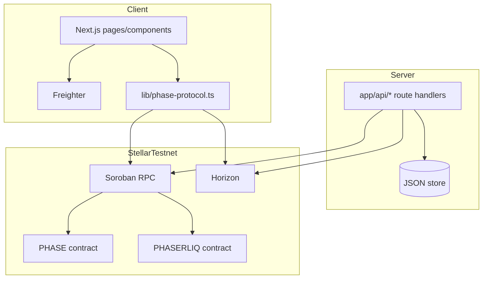

# PHASE Technical Documentation

Professional technical specification for the current repository state.

Primary references:
- [`PROJECT_ARCHITECTURE.md`](../PROJECT_ARCHITECTURE.md)
- [`README.md`](../README.md)
- [`docs/PHASER_LIQ_REWARDS_TERMINAL_DOC.md`](./PHASER_LIQ_REWARDS_TERMINAL_DOC.md)
- [`contracts/README.md`](../contracts/README.md)

---

## 1. System Summary

PHASE is a Next.js + Soroban testnet application where:

- creators register collections;
- users pay PHASERLIQ and mint utility NFTs through settlement;
- rewards/bootstrap APIs support onboarding and testing.

The implementation separates concerns between:

- **Client** (wallet interaction + UI state),
- **Server APIs** (trusted operations and persistence),
- **On-chain contracts** (canonical protocol state).

---

## 2. Runtime Topology



---

## 3. Repository Structure

| Path | Responsibility |
|---|---|
| `app/` | App Router routes, layouts, API handlers, global/tactical styles |
| `components/` | Feature UI components (forge/chamber/rewards/wallet integration) |
| `lib/phase-protocol.ts` | Soroban integration helpers, constants, error normalization |
| `lib/classic-liq.ts` | Classic asset trustline utilities (`changeTrust` XDR, Horizon checks) |
| `lib/phase-copy.ts` | Centralized i18n dictionary (EN/ES) |
| `lib/server-data-paths.ts` | Writable data location abstraction |
| `lib/feature-flags.ts` | Flag registry (phase-121..124, 167, 182, 220, 221; env resolution, rollback notes) |
| `lib/gateway-health.ts` | Gateway latency scoring + dashboard snapshot (phase-121) |
| `lib/offchain-delta.ts` | Off-chain delta store, hash/stub helpers (phase-122) |
| `lib/ipfs-fallback.ts` / `lib/phase-nft-metadata-build.ts` | IPFS timeout fallback chain (phase-123) |
| `lib/metadata-migration.ts` | Metadata version migration v1→v2 (phase-124) |
| `lib/walletconnect-resilience.ts` | Relay failover, chain guard, session resume, deep-link return (phase-167) |
| `lib/liquidity-pool.ts` / `lib/pool-activity-store.ts` | Classic pool quotes, router drift gate, intent idempotency, wash exclusion (phase-182) |
| `lib/explorer-links.ts` | Allow-listed Stellar Expert links + read-only enrichment (phase-220) |
| `lib/albedo-sunset.ts` | Albedo call-site registry, parity-freeze, retired fail-closed gate (phase-221) |
| `lib/security-counters.ts` | Closed observability counter names (including `session_restored`) |
| `lib/json-store.ts` | Locked, atomic JSON sidecar access shared by gated stores |
| `contracts/` | Soroban Rust contracts and tooling docs |
| `docs/` | Technical and operational documentation |

---

## 4. Frontend Routes

| Route | File | Description |
|---|---|---|
| `/` | `app/page.tsx` | Landing page |
| `/forge` | `app/forge/page.tsx` | Collection creation + Oracle flow + rewards |
| `/dashboard` | `app/dashboard/page.tsx` | Market/catalog/listing operations |
| `/chamber` | `app/chamber/page.tsx` | Settlement and artifact interface |
| `/docs` | `app/docs/page.tsx` | In-app product documentation |
| `/.well-known/stellar.toml` | `app/.well-known/stellar.toml/route.ts` | Dynamic SEP-0001 surface |

---

## 5. API Specification

All handlers live in `app/api/**/route.ts`.

### 5.1 Core routes

| Methods | Route | Purpose |
|---|---|---|
| `GET`, `POST` | `/api/faucet` | Reward status + claim execution (server-minted on success). |
| `POST` | `/api/claim-bounty` | Compatibility wrapper over `/api/faucet` with strict typed contract. |
| `GET`, `POST` | `/api/classic-liq` | Classic PHASERLIQ asset status/bootstrap operations. |
| `POST` | `/api/classic-liq/trustline` | Submits user-signed trustline XDR. |
| `POST` | `/api/forge-agent` | Gemini-first forge assistant endpoint with payment gate support. |
| `GET`, `POST` | `/api/nft-listings` | JSON-backed market listing state. |
| `GET`, `PUT` | `/api/artist-profile` | JSON-backed artist alias profile. |
| `GET`, `POST`, etc. | `/api/x402/*` | x402 settlement/verify/supported endpoints. |

### 5.2 Response contracts

- `forge-agent` and `claim-bounty` now use strict TypeScript response unions.
- Error payloads are explicit and status-code aligned.
- No untyped `any` responses should be used for public API contracts.

### 5.3 Flag-gated API extensions

| Flag | Route | Extension | Flag off |
|------|-------|-----------|----------|
| `phase-121` | `GET /api/phase-nft/custodian-release` | Gateway health dashboard: sorted gateway list with latency scoring (`score`, `avgLatencyMs`, `uptime`) | `404` disabled |
| `phase-122` | `POST /api/phase-nft/verify` | Adds `delta` + `storage` fields (off-chain manifest, stub note) | Fields omitted |
| `phase-123` | `GET /api/metadata/[id]` & `GET /api/ipfs/[...cid]` | Adds `X-Phase-*` headers, per-gateway timeout, structured `perGateway` error | Legacy 8s sequential, no headers |
| `phase-124` | `scripts/*` | Migration logs, `--migrate-metadata` CLI | No-op with hint |
| `phase-167` | `POST /api/wallet/session` | Closed session telemetry events (`session_restored`, `wc_*`) | `404` disabled |
| `phase-182` | `GET/POST /api/liquidity-pools` | Quotes (quote hash + min-out), unsigned XDR prepare, Horizon-verified `record`; 409 stale/conflict, 412 trustlines, 503 router drift | `404` disabled |
| `phase-220` | `GET /api/explorer/enrichment` | Read-only tx/asset metadata, 3s timeout, `ok:false` fallback on failure | `404` disabled |
| `phase-221` | `GET /api/albedo/status` | Sunset mode, pinned version check, call-site registry | `404` disabled |

---

## 6. On-chain Integration

### 6.1 Contract IDs and validation

`lib/phase-protocol.ts` enforces Soroban contract ID validity (`C...`) and rejects classic account IDs (`G...`) where contracts are expected.

Key constants:

- `CONTRACT_ID` (PHASE protocol contract)
- `TOKEN_ADDRESS` (PHASERLIQ contract)
- `RPC_URL`, `HORIZON_URL`, `NETWORK_PASSPHRASE`

### 6.2 Transaction model

- **Read paths**: simulation + retval parsing.
- **Write paths**: unsigned XDR construction -> Freighter signature -> submit + confirmation polling.
- **Error mapping**: protocol-level normalization (including unauthorized gate `#13`).

---

## 7. Rewards and Trustline Model

The reward flow is trustline-first:

1. Query reward state.
2. Ensure classic trustline exists when required.
3. Claim reward via faucet-compatible endpoint.
4. Refresh balances and UI state.

Detailed operational flow is documented in:
[`docs/PHASER_LIQ_REWARDS_TERMINAL_DOC.md`](./PHASER_LIQ_REWARDS_TERMINAL_DOC.md)

---

## 8. Internationalization Rules

- User-facing strings must come from `lib/phase-copy.ts`.
- Components should not hardcode visible text.
- New feature work must include EN/ES keys before merge.

---

## 9. Environment Variables

Canonical reference remains:
[`/.env.local.example`](../.env.local.example)

Critical groups:

- Protocol/token contract IDs (`NEXT_PUBLIC_*`, server-side variants)
- Reward signer (`ADMIN_SECRET_KEY`)
- Classic asset configuration (`CLASSIC_LIQ_*`, `NEXT_PUBLIC_CLASSIC_*`)
- Gemini runtime (`GEMINI_API_KEY`)
- Writable server data directory (`PHASE_SERVER_DATA_DIR`)

### 9.1 Feature flags (phase-121..124, 167, 182, 220, 221)

All flags default to **off** (safe rollback). Set to `1`/`true` to enable.

```
# Rolling delivery (legacy set)
NEXT_PUBLIC_FEATURE_PHASE_121=1
NEXT_PUBLIC_FEATURE_PHASE_122=1
NEXT_PUBLIC_FEATURE_PHASE_123=1
NEXT_PUBLIC_FEATURE_PHASE_124=1
# Gated integrations
NEXT_PUBLIC_FEATURE_PHASE_167=1
NEXT_PUBLIC_FEATURE_PHASE_182=1
NEXT_PUBLIC_FEATURE_PHASE_220=1
NEXT_PUBLIC_FEATURE_PHASE_221=1
# Server-only aliases also accepted: FEATURE_PHASE_167, etc.
```

Rollback: unset the var or set `0` and restart. No ledger migration to revert; sidecars (`liquidity-pool-intents.json`, `pool-activity.json`) and WC session metadata stay inert when their flags are off. See `PROJECT_ARCHITECTURE.md` §10 and §12.

### 9.2 Gated integration verification

- **phase-220**: `npx tsx --test lib/__tests__/explorer-links.test.ts` — link correctness, mainnet fence, PII-field rejection, timeout fallback.
- **phase-182**: `npx tsx --test lib/__tests__/liquidity-pool.test.ts` — quote hash/min-out, 409 stale/conflict, router drift, seed-capital arithmetic, wash exclusion, unsigned XDR builders. Live proof: `npx tsx scripts/phase-182-pool-proof.ts` (requires a funded testnet key; writes `phase-182-pool-proof.json` with real tx hashes, never fabricated).
- **phase-221**: `npx tsx --test lib/__tests__/albedo-sunset.test.ts` — mode resolution, call-site gate, pin drift, migration copy.
- **phase-167**: `npx tsx --test lib/__tests__/walletconnect-resilience.test.ts` — relay failover, chain guard, session resume counter, deep-link return.

---

## 10. Security and Operations

- Never commit private credentials.
- Keep server-only secrets out of client runtime.
- Use writable server storage abstraction (`server-data-paths`) for platform-safe behavior.
- On contract redeploys, update:
  - env values,
  - architecture/technical docs,
  - any static references.

---

## 11. Build and Verification

```bash
npm install
npm run dev
npm run build
npx tsc --noEmit
```

Contract commands are documented in [`contracts/README.md`](../contracts/README.md).

---

## 12. External References

- [Soroban Smart Contracts](https://developers.stellar.org/docs/build/smart-contracts)
- [SEP-0001](https://github.com/stellar/stellar-protocol/blob/master/ecosystem/sep-0001.md)
- [Freighter Docs](https://docs.freighter.app/)
- [Stellar x402](https://developers.stellar.org/docs/build/agentic-payments/x402)
