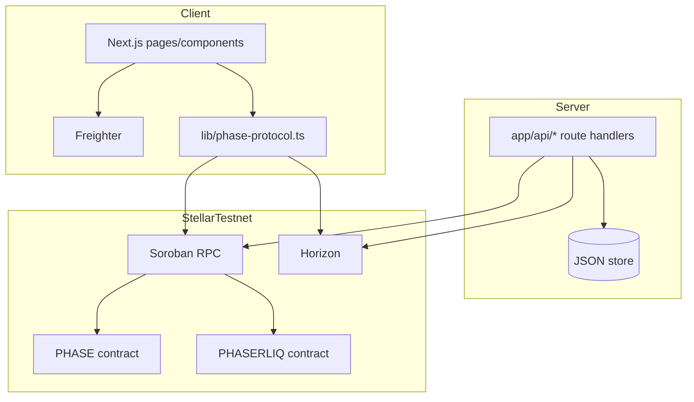

# PHASE Technical Documentation

Professional technical specification for the current repository state.

Primary references:
- [`PROJECT_ARCHITECTURE.md`](../PROJECT_ARCHITECTURE.md)
- [`README.md`](../README.md)
- [`docs/PHASER_LIQ_REWARDS_TERMINAL_DOC.md`](./PHASER_LIQ_REWARDS_TERMINAL_DOC.md)
- [`contracts/README.md`](../contracts/README.md)

---

## 1. System Summary

PHASE is a Next.js + Soroban testnet application where:

- creators register collections;
- users pay PHASERLIQ and mint utility NFTs through settlement;
- rewards/bootstrap APIs support onboarding and testing.

The implementation separates concerns between:

- **Client** (wallet interaction + UI state),
- **Server APIs** (trusted operations and persistence),
- **On-chain contracts** (canonical protocol state).

---

## 2. Runtime Topology



---

## 3. Repository Structure

| Path | Responsibility |
|---|---|
| `app/` | App Router routes, layouts, API handlers, global/tactical styles |
| `components/` | Feature UI components (forge/chamber/rewards/wallet integration) |
| `lib/phase-protocol.ts` | Soroban integration helpers, constants, error normalization |
| `lib/classic-liq.ts` | Classic asset trustline utilities (`changeTrust` XDR, Horizon checks) + CID integrity helpers via `cid-cache` (phase-119) + rate-limit-aware batch submission to Horizon (phase-134) |
| `lib/phase-copy.ts` | Centralized i18n dictionary (EN/ES) |
| `lib/server-data-paths.ts` | Writable data location abstraction |
| `lib/json-store.ts` | Serialized read-modify-write + atomic write for the JSON sidecar stores (§5.4) |
| `lib/feature-flags.ts` | Flag registry (phase-107,111,113,114 + 116,117,119,120 + 121..124, env resolution, rollback notes) |
| `lib/world-conflict.ts` | World save conflict detection (phase-105): version check + per-author vector clock normalization (object / `Map` / entries array) and ordering |
| `lib/story-arc-continuity.ts` | AI story-arc continuity check against recent world narratives (phase-107) |
| `lib/narrative-world-store.ts` | World/narrative JSON store + localized per-(tokenId,lang) narrative cache (phase-111) + world export snapshot builder and markdown renderer (phase-112) + collaborative role store with ownership enforcement (phase-109) + lore link store with back-reference index (phase-115) |
| `lib/ipfs-upload-retry.ts` | IPFS upload retry w/ exponential backoff + sha256 checksum (phase-120) |
| `lib/cid-cache.ts` | CID content-addressing cache with integrity verification (phase-119) |
| `lib/cid-verification.ts` | CID multihash verification + `metadata_uri` allowlist; gates the shared-cache lifetime (#229) |
| `lib/viewer-authorization.ts` | Gated-preview grant: token/expiry/`jti`-bound viewer signature, single-use via `viewer_jti` (#227) |
| `lib/security-counters.ts` | Security counter registry (gated preview, CID, wash, distributor) with closed label sets (#227, #229, #230, #231) |
| `lib/wash-screening.ts` | Offer wash screen + volume aggregates excluding wash-flagged offers (#230) |
| `lib/distributor-ledger.ts` | Distributor balance ledger + `BEGIN IMMEDIATE` refill reservation (#231) |
| `lib/ipfs-pinning.ts` | Multi-gateway pinning with quorum + fallback fetch (phase-117) |
| `lib/profile-store.ts` | Profile JSON store + avatar redundancy helpers (phase-117) |
| `lib/contributor-ledger.ts` | Contributor ledger & credit distribution (phase-116) |
| `lib/signal-store.ts` | Signals/replies + attribution ledger wiring (phase-116) + moderation takedown/restore (phase-113) |
| `lib/achievement-store.ts` | Achievement unlocks JSON store + chronological timeline (phase-114) |
| `lib/gateway-health.ts` | Gateway latency scoring + dashboard snapshot (phase-121) |
| `lib/offchain-delta.ts` | Off-chain delta store, hash/stub helpers (phase-122) |
| `lib/ipfs-fallback.ts` / `lib/phase-nft-metadata-build.ts` | IPFS timeout fallback chain, gateway priority ordered by live health score (phase-123) |
| `lib/metadata-migration.ts` | Metadata version migration v1→v2 (phase-124) |
| `lib/wallet-nft-index-cache.ts` | LRU-cached wallet NFT token-id index with stale-on-error fallback (phase-135) |
| `lib/explore-owners-cache.ts` | Cached Explore owner-scan result with stale-on-error fallback (phase-135) |
| `lib/buyback-burn.ts` | Treasury buyback and burn accounting from marketplace fees (phase-146) |
| `lib/staked-forge-discounts.ts` | Staked FORGE tier discounts on x402 endpoints and settlement (phase-147) |
| `lib/bonding-curve.ts` | Continuous bonding curves for open edition drops with supply-priced minting (phase-148) |
| `lib/prediction-markets.ts` | Prediction markets on drop outcomes with resolve-to-creator bonus (phase-149) |
| `contracts/` | Soroban Rust contracts and tooling docs |
| `docs/` | Technical and operational documentation |

---

## 4. Frontend Routes

| Route | File | Description |
|---|---|---|
| `/` | `app/page.tsx` | Landing page |
| `/forge` | `app/forge/page.tsx` | Collection creation + Oracle flow + rewards |
| `/dashboard` | `app/dashboard/page.tsx` | Market/catalog/listing operations |
| `/chamber` | `app/chamber/page.tsx` | Settlement and artifact interface |
| `/docs` | `app/docs/page.tsx` | In-app product documentation |
| `/.well-known/stellar.toml` | `app/.well-known/stellar.toml/route.ts` | Dynamic SEP-0001 surface |

---

## 5. API Specification

All handlers live in `app/api/**/route.ts`.

### 5.1 Core routes

| Methods | Route | Purpose |
|---|---|---|
| `GET`, `POST` | `/api/faucet` | Reward status + claim execution (server-minted on success). |
| `POST` | `/api/claim-bounty` | Compatibility wrapper over `/api/faucet` with strict typed contract. |
| `GET`, `POST` | `/api/classic-liq` | Classic PHASERLIQ asset status/bootstrap operations. |
| `POST` | `/api/classic-liq/trustline` | Submits user-signed trustline XDR. |
| `POST` | `/api/forge-agent` | Gemini-first forge assistant endpoint with payment gate support. |
| `GET`, `POST` | `/api/nft-listings` | JSON-backed market listing state. |
| `GET`, `PUT` | `/api/artist-profile` | JSON-backed artist alias profile. |
| `GET`, `POST` | `/api/signals` | Signal board listing + creation. |
| `GET`, `POST` | `/api/signals/[id]` | Signal detail (with `ETag`) + upvote toggle. |
| `POST` | `/api/signals/[id]/replies` | Append a reply, optionally gated on `parent_version`. |
| `GET`, `POST`, etc. | `/api/x402/*` | x402 settlement/verify/supported endpoints. |

The legacy local x402 shim is fail-closed. Set `X402_LOCAL_SHIM_ENABLED=true` only for
local compatibility testing; production payment verification must use the on-chain
settlement verifier and must not accept unsigned base64 payloads.

### 5.2 Response contracts

- `forge-agent` and `claim-bounty` now use strict TypeScript response unions.
- Error payloads are explicit and status-code aligned.
- No untyped `any` responses should be used for public API contracts.
- `POST /api/signals` and `POST /api/signals/[id]/replies` now require a real
  SEP-53 Ed25519 `signature` over `{ title, body, timestamp }` (signals) or
  `{ title: "", body, timestamp }` (replies), plus a numeric `timestamp`. The
  server verifies ownership with `Keypair.fromPublicKey(wallet).verify(...)`
  and returns `400` for missing/invalid/forged signatures. Verified authorship
  is persisted as `signature_verified` and shown as a verified badge in the UI.

### 5.3 Flag-gated API extensions

| Flag | Route | Extension | Flag off |
|------|-------|-----------|----------|
| `phase-105` | `POST /api/world` | Accepts `expected_version` and `expected_vector_clock`; `409 WORLD_VERSION_CONFLICT` with `order`, `server_version`, `server_vector_clock`, `current` when the client's view is stale or concurrent. Success returns the new `version` and `vector_clock` | Unconditional overwrite |
| `phase-109` | `GET /api/world/[collection_id]/roles` | Returns current role map (`editor`/`viewer`) for the world collection | `404` disabled |
| `phase-109` | `POST /api/world/[collection_id]/roles` | Assigns a role to a target wallet; requires `X-Wallet-Signature` header and acting wallet must be the world owner (403 otherwise) | `404` disabled |
| `phase-110` | `GET /api/world/search` | Full-text narrative search across all world collections; supports `?entity=<id>`, `?location=<text>`, `?q=<text>` | `404` disabled |
| `phase-112` | `GET /api/world/[collection_id]/export` | Exports a world snapshot as `json` (default) or `markdown` via `?format=`; responds with `Content-Disposition: attachment` | `404` disabled |
| `phase-115` | `GET /api/world/narrative/[token_id]/links` | Returns `outgoing` and `incoming` lore links for a narrative token | `404` disabled |
| `phase-115` | `POST /api/world/narrative/[token_id]/links` | Creates a directed lore link from `token_id` to a `to_token_id` with an optional `note`; upserts on duplicate | `404` disabled |
| `phase-107` | `POST /api/narrator` | Checks new narrative against the world's recent narratives (Gemini); `409 CONTINUITY_CONTRADICTION` on a detected contradiction | No check, generation always saves |
| `phase-111` | `GET /api/world/narrative/[token_id]` | Reads through a per-(tokenId, `?lang=`) cache with a short TTL | Direct store read every request |
| `phase-113` | `POST /api/signals/[id]/moderate` | Takedown/restore a signal (`x-admin-key` gated); taken-down signals excluded from `GET /api/signals` | `404` disabled, no filtering |
| `phase-114` | `GET /api/achievements` | Adds `timeline` field: achievement unlocks ordered oldest-first with names | Field omitted |
| `phase-116` | `POST/GET /api/signals/[id]/replies` | Narrative contributor attribution: `contributors`, `creditLedger` on reply create; `GET` ledger endpoint with shareBps/roles | `404` disabled, ledger empty |
| `phase-117` | `GET/POST /api/profile/avatar` | Multi-gateway redundancy: `GET` rewrites avatar URL via verified gateway (headers `X-Phase117`), `POST` pins with quorum (`quorum`, `achieved`, `checksum`) | Single gateway, no quorum |
| `phase-119` | `POST/GET /api/classic-liq/trustline` | CID cache + integrity: validates `cid`/`expectedSha256`/`cidPath`, `GET` exposes cache stats, headers `X-Phase119` | Direct submit, no verification |
| `phase-134` | `POST /api/classic-liq/trustline` | Accepts `signedXdrs: string[]` (batch) alongside legacy `signedXdr`; submits with bounded concurrency + 429/503 backoff | Each XDR submits immediately and sequentially, no retry |
| `phase-135` | `GET /api/wallet/phase-nfts` | Serves the wallet's token-id index from an LRU cache when fresh; degrades to stale cached data (not a 503) if every live lookup fails; logs scan duration | No cache; a live-lookup failure propagates as before |
| `phase-135` | `GET /api/explore` | Serves the raw owner-scan result from cache when fresh; degrades to the last-known-good scan (not a 500) if a live scan fails | No cache; a scan failure fails the request as before |
| `phase-120` | `POST /api/ipfs` & `GET /api/og/*` | Upload retry + checksum: `POST /api/ipfs` retries with backoff (`X-Checksum-Sha256`, `X-Phase120-Attempts`), `GET /api/og/*` supports `?pin=1` & reports `X-Phase-Pin-*`, `X-Phase-Og-Template` | Single-shot Pinata, no pin headers |
| `phase-121` | `GET /api/phase-nft/custodian-release` | Gateway health dashboard: sorted gateway list with latency scoring (`score`, `avgLatencyMs`, `uptime`) | `404` disabled |
| `phase-122` | `POST /api/phase-nft/verify` | Adds `delta` + `storage` fields (off-chain manifest, stub note) | Fields omitted |
| `phase-123` | `GET /api/metadata/[id]` & `GET /api/ipfs/[...cid]` | Adds `X-Phase-*` headers, per-gateway timeout, structured `perGateway` error | Legacy 8s sequential, no headers |
| `phase-124` | `scripts/*` | Migration logs, `--migrate-metadata` CLI | No-op with hint |
| `phase-82` | `PATCH /api/signals/[id]` & `GET /api/signals/[id]/history` | Author-only edit with pre-edit version snapshot; `If-Match` is required and stale versions return `409`; history route returns versions + word-level diffs (`diffWords`) | `404` disabled, no edit path |
| `phase-83` | `GET/POST /api/signals/[id]/reactions` | Toggle a curated emoji reaction per (signal, wallet); `GET` returns per-emoji counts + the viewer's own reacted flags; `POST` rate-limited to 20/60s per wallet (`429` + `Retry-After` over the limit) | `404` disabled |
| `phase-139` | `GET/POST /api/market/collections/[collection_id]/offer-book` | `GET` aggregates every pending offer across a collection's active listings into price levels (best price first); `POST` fans a single buyer intent into up to 20 per-listing offers, reporting `created`/`skipped` | `404` disabled; per-listing `/api/market/[id]/offers` unaffected |
| `phase-140` | `POST /api/market/route.ts` (listing create) & `POST /api/market/[id]/offers/[offer_id]` (accept) | Listing create accepts `creator_wallet`/`royalty_bps`; accepting an offer on a secondary sale (`creator_wallet !== seller_wallet`) computes and ledgers a creator/seller split, returned as `royalty` on the accept response | Listing create ignores the fields; accept pays 100% to seller as before |
| `phase-141` | `GET/POST /api/signals/[id]/crdt` & `PUT /api/signals/[id]` | Yjs CRDT collaborative draft for signal lore: automatic merge of concurrent edits, exposed as an `enabled` draft panel on the signal page. `PUT` with `from_draft: true` promotes a merged draft through the normal CAS commit and snapshots the pre-edit text | `404` disabled, no draft panel; `PUT` still works on its own as an `If-Match`-guarded full replacement |
| `phase-142` | `GET /api/ipfs/[...cid]` | Responsive focal-crop variants and query transforms (`variant`, `w`, `h`, `fx`, `fy`), adding `X-Phase-Image-Variant` and `X-Phase-Focal-Crop` headers | Standard raw IPFS proxy response without transforms |
| `phase-143` | `GET/POST /api/notifications/winback` | AI-driven churn and winback: dormancy tier classification, tailored return hooks, randomized experiment cohorts, and 7-day fatigue caps | `404` disabled |
| `phase-144` | `GET/POST /api/governance/ve-lock` | ve-PHASELQ time-locked governance escrow: decaying lock weight (`1-208` weeks), pro-rata treasury fee-share distribution, and claims | `404` disabled |
| `phase-145` | `GET/POST /api/governance/gauge` | Gauge voting for emissions: ve-weight-proportional votes directing weekly quest budget allocations across collections | `404` disabled |

### 5.3 Signal concurrency contract

Signals and replies are stored in SQLite (`signals`, `signal_replies`,
`signal_versions`, `signal_reactions` in `lib/sqlite-db.ts`), not in a JSON
sidecar. The connection runs in WAL mode with `foreign_keys = ON`.

Each `Signal` carries an integer `version` in the `signals` table, starting at
`1` and bumped on every mutation. `1` matters: the version is published as an
ETag and echoed back as `If-Match` / `parent_version`, and all three reject `0`.

The lost-update hazard is `upvoteSignal`, the only read-modify-write over a
JSON blob (`upvotes_json`). It is guarded three ways:

1. **Version-guarded write.** The `UPDATE` names the version it read:
   `... WHERE id = ? AND version = ?`. A writer whose row was superseded
   matches zero rows instead of clobbering.
2. **Bounded retry.** `upvoteSignal` re-reads and recomputes on a lost CAS,
   up to `MAX_CAS_ATTEMPTS` (8). Because the guard is version-based rather
   than wall-clock, retries converge.
3. **Transactional parent check.** `createReply` and `editSignal` verify the
   parent version inside the same `BEGIN IMMEDIATE` as their write, so the
   check cannot be invalidated between the test and the write.

A stale value throws `VersionConflictError`, which the API maps to `409`.

| Surface | Contract |
|---|---|
| `GET /api/signals/[id]` | Returns `ETag: "<version>"`. |
| `POST /api/signals/[id]` | Optional `If-Match: "<version>"`. Stale value → `409` with `current_version` and the fresh `ETag`. |
| `POST /api/signals/[id]/replies` | Optional `parent_version: <int>`. Stale value → `409` with `current_version`. |
| `PATCH /api/signals/[id]` | `If-Match` required (phase-82). Stale value → `409` with `current_version` and the fresh `ETag`. |
| `PUT /api/signals/[id]` | `If-Match` required. Full replacement of `title` **and** `body`, so a revision is never half-applied. Stale value → `409` with `current_version` and the fresh `ETag`. |
| `GET /api/signals/[id]/crdt` | Collaborative draft (phase-141). Optional `?state_vector=` returns only the operations that client lacks. |
| `POST /api/signals/[id]/crdt` | Collaborative draft (phase-141). Merges a base64 Yjs update. Never touches `signals`. |

`If-Match` and `parent_version` are optional on the upvote and reply paths, so
clients that omit them keep last-writer-wins behaviour. Conflicts emit the
`signals.version_conflict` log event.

Rows written before the column existed are normalized to `1` by an idempotent
migration in `getDb()`.

**Cross-instance behaviour.** Unlike a per-process lock, the version guard and
WAL transactions hold across processes, so two Vercel instances sharing the
database file no longer interleave destructively. `lib/__tests__/signal-store-concurrency.test.ts`
drives this directly with a second `DatabaseSync` handle committing between one
connection's read and its write.

**Committed lore is not a CRDT.** Signals are versioned, not collaboratively
edited: an author's edit takes a pre-edit snapshot into `signal_versions` and
must stay revertible. A merge-based CRDT applied to the committed row would fold
concurrent edits together and destroy that history, so the commit contract is
compare-and-swap rather than automatic merge.

**The draft *is* a CRDT (phase-141).** Issue #207 measured what CAS alone does
when 50 people type into the same signal at once, and it keeps one of the fifty
texts (`lib/__tests__/signal-crdt-benchmark.test.ts`):

| Strategy | Preserved | Outcome |
|---|---|---|
| `version` + CAS | 1/50 | 1 committed, 49 rejected `409`, text clobbered |
| Yjs CRDT draft | 50/50 | 50 updates folded into one snapshot, 0 rejected |

The two therefore compose instead of competing. CRDTs merge *concurrent
proposals*; they cannot decide which text is authoritative, and they cannot write
revertible history. So:

- `signal_crdt_docs` / `signal_crdt_updates` hold a **scratch draft** that merges
  automatically and never writes the `signals` row.
- `PUT /api/signals/[id]` with `from_draft: true` promotes a merged draft into the
  committed row through the same `editSignal` CAS path, snapshotting the pre-edit
  text into `signal_versions` exactly as a manual edit does.
- Conflicts remain possible and remain visible at the commit boundary: if a
  colleague committed while the draft was open, `PUT` still answers `409`. The
  CRDT removes *lost* updates, it does not remove the need for a guard.

`lib/signal-crdt.ts` holds the document model (a `lore` Y.Map of `title` and
`body` Y.Text), and edits are applied as a minimal span diff — common prefix and
suffix are left alone — so two appends become two independent inserts instead of
one overwriting the other. `lib/signal-crdt-store.ts` merges inside
`BEGIN IMMEDIATE` and folds the update tail into the snapshot every
`COMPACT_AFTER_UPDATES` (64) merges, so the tail cannot grow without bound.

**Transport is HTTP, not WebSocket.** Yjs is transport-agnostic and speaks
state-vector diffs, so a `GET` with the client's state vector returns precisely
the operations it lacks — the same wire format a socket would carry, without
holding a connection open. That matters here because the app deploys to Vercel
serverless, where a long-lived socket per reader is not available. The client
hook in `app/signals/[id]/use-signal-crdt.ts` posts on a short debounce and
polls while the panel is open.

**Metrics.** `lib/signal-version-metrics.ts` keeps process-local counters for
`signal_version_conflicts` (split by `edit` / `put` / `upvote` / `reply` / `vote`, and
flagged separately when a CAS retry was attempted) plus `signal_crdt_merges`,
`signal_crdt_concurrent_merges` and commit outcomes. The store is the only place
that increments them, so a rejected CAS is counted once no matter how many layers
observe it. The counters are aggregate only — no signal id, wallet, or text ever
reaches a metric label.

### 5.4 Shared JSON sidecar store layer

`lib/json-store.ts` provides the same three guarantees described in §5.3 —
serialized mutation, atomic replacement, and fatal corruption — as a reusable
module, and the remaining JSON sidecar stores route their mutations through it
rather than hand-rolling a `readFile`/`writeFile` pair per module.

| Export | Purpose |
|---|---|
| `updateStore(key, mutate)` | Locked read-modify-write for a registered sidecar file. The normal way to mutate one. |
| `updateStoreWithReader(key, read, mutate)` | As above, with an on-disk shape adapter applied before mutation. |
| `updateJsonFile(path, { read?, mutate })` | As above, for a path outside the `serverDataJsonPath` registry. |
| `readStore(key, fallback)` / `readJsonFile(path, fallback)` | Unlocked reads. Missing file → `fallback`; corrupt file → throws. |
| `writeJsonFileAtomic(path, data)` | Unlocked atomic write. Torn-write safety only, not lost-update safety. |
| `withFileLock(path, task)` | Escape hatch. Almost always prefer `updateStore`, which keeps the read and write in one critical section. |

Stores migrated: `follow-store`, `profile-store`, `notification-store`,
`achievement-store`, `narrative-world-store`, and the JSON-backed paths in
`market-store` (`marketProfileViews`, `blockList`; listings and offers are
already SQLite).

`updateStore` accepts an async `mutate`, but **the lock is not reentrant**: a
`mutate` callback must not call a locking store function for the same file, or it
deadlocks waiting on its own queue. Two places depend on this contract —
`createNotificationBatch` resolves notification preferences (a different store)
*before* taking the notifications lock, and `checkAndUnlock` applies its unlocks
to the in-flight store object rather than re-entering through
`unlockAchievement`.

**The same per-process limit in §5.3 applies here.** Serialization and atomic
replacement remove the lost update within one process; they do not reconcile
state across serverless instances.

---

## 6. On-chain Integration

### 6.1 Contract IDs and validation

`lib/phase-protocol.ts` enforces Soroban contract ID validity (`C...`) and rejects classic account IDs (`G...`) where contracts are expected.

Key constants:

- `CONTRACT_ID` (PHASE protocol contract)
- `TOKEN_ADDRESS` (PHASERLIQ contract)
- `RPC_URL`, `HORIZON_URL`, `NETWORK_PASSPHRASE`

### 6.2 Transaction model

- **Read paths**: simulation + retval parsing.
- **Write paths**: unsigned XDR construction -> Freighter signature -> submit + confirmation polling.
- **Error mapping**: protocol-level normalization (including unauthorized gate `#13`).

---

## 7. Rewards and Trustline Model

The reward flow is trustline-first:

1. Query reward state.
2. Ensure classic trustline exists when required.
3. Claim reward via faucet-compatible endpoint.
4. Refresh balances and UI state.

Detailed operational flow is documented in:
[`docs/PHASER_LIQ_REWARDS_TERMINAL_DOC.md`](./PHASER_LIQ_REWARDS_TERMINAL_DOC.md)

---

## 8. Internationalization Rules

- User-facing strings must come from `lib/phase-copy.ts`.
- Components should not hardcode visible text.
- New feature work must include EN/ES keys before merge.

---

## 9. Environment Variables

Canonical reference remains:
[`/.env.local.example`](../.env.local.example)

Critical groups:

- Protocol/token contract IDs (`NEXT_PUBLIC_*`, server-side variants)
- Reward signer (`ADMIN_SECRET_KEY`)
- Classic asset configuration (`CLASSIC_LIQ_*`, `NEXT_PUBLIC_CLASSIC_*`)
- Gemini runtime (`GEMINI_API_KEY`)
- Writable server data directory (`PHASE_SERVER_DATA_DIR`)

### 9.1 Feature flags (phase-82..149)

All flags default to **off** (safe rollback). Set to `1`/`true` to enable.

```
# Enable all supported flags (example)
NEXT_PUBLIC_FEATURE_PHASE_88=1
NEXT_PUBLIC_FEATURE_PHASE_89=1
NEXT_PUBLIC_FEATURE_PHASE_90=1
NEXT_PUBLIC_FEATURE_PHASE_91=1
NEXT_PUBLIC_FEATURE_PHASE_107=1
NEXT_PUBLIC_FEATURE_PHASE_109=1
NEXT_PUBLIC_FEATURE_PHASE_110=1
NEXT_PUBLIC_FEATURE_PHASE_111=1
NEXT_PUBLIC_FEATURE_PHASE_112=1
NEXT_PUBLIC_FEATURE_PHASE_113=1
NEXT_PUBLIC_FEATURE_PHASE_114=1
NEXT_PUBLIC_FEATURE_PHASE_115=1
NEXT_PUBLIC_FEATURE_PHASE_116=1
NEXT_PUBLIC_FEATURE_PHASE_117=1
NEXT_PUBLIC_FEATURE_PHASE_119=1
NEXT_PUBLIC_FEATURE_PHASE_120=1
NEXT_PUBLIC_FEATURE_PHASE_121=1
NEXT_PUBLIC_FEATURE_PHASE_122=1
NEXT_PUBLIC_FEATURE_PHASE_123=1
NEXT_PUBLIC_FEATURE_PHASE_124=1
NEXT_PUBLIC_FEATURE_PHASE_134=1
NEXT_PUBLIC_FEATURE_PHASE_135=1
NEXT_PUBLIC_FEATURE_PHASE_82=1
NEXT_PUBLIC_FEATURE_PHASE_83=1
NEXT_PUBLIC_FEATURE_PHASE_139=1
NEXT_PUBLIC_FEATURE_PHASE_140=1
NEXT_PUBLIC_FEATURE_PHASE_141=1
NEXT_PUBLIC_FEATURE_PHASE_146=1
NEXT_PUBLIC_FEATURE_PHASE_147=1
NEXT_PUBLIC_FEATURE_PHASE_148=1
NEXT_PUBLIC_FEATURE_PHASE_149=1
# Spikes 655/656/657/660 (issues #517/#518/#520/#523)
NEXT_PUBLIC_FEATURE_PHASE_158=1
NEXT_PUBLIC_FEATURE_PHASE_159=1
NEXT_PUBLIC_FEATURE_PHASE_160=1
NEXT_PUBLIC_FEATURE_PHASE_161=1
# Spikes 603/604/605/606 (issues #467/#468/#469/#470)
NEXT_PUBLIC_FEATURE_PHASE_170=1
NEXT_PUBLIC_FEATURE_PHASE_171=1
NEXT_PUBLIC_FEATURE_PHASE_172=1
NEXT_PUBLIC_FEATURE_PHASE_173=1
# Server-only aliases also accepted: FEATURE_PHASE_104, etc.
```

Agent tuning (all optional, server-only):

| Variable | Default | Used by |
|---|---|---|
| `PHASE_ADMIN_KEY` | unset → operator routes `503` | phase-142/143/146/147 operator routes (`x-admin-key`) |
| `PHASE_AI_JSON_TIMEOUT_MS` | `20000` | structured model step |
| `PHASE_AI_COST_PER_1K_INPUT_CHARS` / `…_OUTPUT_CHARS` | `0.00002` / `0.00008` | cost attribution ledger |
| `PHASE_PRICING_CONTROL_PCT` | `10` | pricing A/B control share |
| `PHASE_MODERATION_HOLD_UNSCORED` | unset | `1` hides new content until scored |
| `PHASE_QUEST_ARC_MAX_STROOPS` | `150000000` (15 PHASELQ) | per-arc reward cap |

Rollback: unset the var or set `0` and restart. No ledger migration to revert; off-chain stores remain but are ignored when flag off. See `PROJECT_ARCHITECTURE.md` §10.

**Proposed, not registered:** spike batch 550–599 (refundable settlement, live
updates, collaborative canvas, WebGL viewer) is documented in
[`docs/spikes/SPIKE_INDEX_550_599.md`](./spikes/SPIKE_INDEX_550_599.md). The
proposed names `phase-550`–`phase-553` are intentionally absent from
`lib/feature-flags.ts` until a route or behavior exists to gate; each spike doc
carries its own rollback and acceptance plan.

---

## 10. Security and Operations

- Never commit private credentials.
- Keep server-only secrets out of client runtime.
- Use writable server storage abstraction (`server-data-paths`) for platform-safe behavior.
- Any store mutated by more than one writer needs serialized read-modify-write,
  atomic file replacement, and a version/compare-and-swap field. See §5.3.
- Mutate the JSON sidecar stores only through `lib/json-store.ts`
  (`updateStore` / `updateStoreWithReader` / `updateJsonFile`). Never pair a raw
  `readFile` with a `writeFile`; that is the lost-update race §5.4 exists to
  prevent. Locks are not reentrant — see §5.4.
- Watch for the `signals.version_conflict` log event to detect clients that are
  writing against stale reads.
- On contract redeploys, update:
  - env values,
  - architecture/technical docs,
  - any static references.

---

## 11. Build and Verification

```bash
npm install
npm run dev
npm run build
npm run typecheck
npm run lint
npm test
```

`npm test` (vitest) covers the JSON store concurrency contract described in §5.3,
including the 50-concurrent-writer cases. Each test runs against its own
`PHASE_SERVER_DATA_DIR` temp directory, so it never touches `.data`.

Contract commands are documented in [`contracts/README.md`](../contracts/README.md).

### 11.1 CI/CD

`.github/workflows/ci.yml` runs on every PR and push to `main`:

- `contracts` — compiles and tests both Soroban crates (`mock-token`, `phase-protocol`) against `wasm32-unknown-unknown`.
- `web` — `npm run lint` (non-blocking: 286 pre-existing errors), `npm run typecheck` and `npm test` (both blocking), and `npm run build`.
- `deploy-staging` — on push to `main` only, behind a `staging` GitHub environment: builds + optimizes `phase-protocol` and runs `scripts/deploy-phase-sep50.ts` against testnet using repo secrets/vars.

---

## 12. External References

- [Soroban Smart Contracts](https://developers.stellar.org/docs/build/smart-contracts)
- [SEP-0001](https://github.com/stellar/stellar-protocol/blob/master/ecosystem/sep-0001.md)
- [Freighter Docs](https://docs.freighter.app/)
- [Stellar x402](https://developers.stellar.org/docs/build/agentic-payments/x402)

---

## 13. Gated content, CID verification and market integrity

Three security properties that interact, and are easy to get individually right
and collectively wrong. Findings and measurements are in `docs/spikes/`.

### Gated preview authorization (#227)

```
signedPayload = SHA256("Phase SEP50" | networkPassphrase | contractId |
                       viewer | tokenId | exp | jti)
signedBytes   = "Stellar Signed Message:\n" + "phase-viewer:v1:" + hex(signedPayload)
```

Every field is inside the digest, so none can be swapped after signing:
`networkPassphrase` blocks cross-network replay, `contractId` blocks
cross-contract replay, `tokenId` blocks one signature opening every gated token,
`exp` bounds the window to 300s (±30s skew), and `jti` makes each signature
single-use.

`jti` is consumed with `INSERT … ON CONFLICT (jti) DO NOTHING` against
`viewer_jti`. The primary key does the work, so two concurrent presentations
cannot both win — a read-then-write in the request path would let exactly that
race through. The `jti` is consumed **after** the signature verifies, so a
signature that fails verification is not burned.

**The signature lifetime is not the security boundary — the cache layer is.** A
300-second `exp` on a response marked `public, s-maxage=31536000` is still a
year-long bearer token. Gated responses are therefore `private, no-store` with
`Vary: Authorization`.

`POST /api/phase-nft/verify` returns `gatedVerified: false` when no signature is
present. Default-deny: gated content stays gated when the signature path is
absent or broken.

### CID verification (#229)

`cid-cache.ts` verifies cached bytes against a **stored** digest, which catches
corruption but not a client-supplied CID — an attacker who supplies both the CID
and the payload satisfies that check, because the stored digest was computed
from the attacker's own bytes. `verifyCID` recomputes the digest **from the CID
itself**:

| Input | Result |
|---|---|
| CIDv0 `Qm…` | base58btc, multihash `0x12 0x20`, recompute sha2-256 |
| CIDv1 `bafy…` | base32, sha2-256 length 32, recompute sha2-256 |
| CIDv1 `bafb…` (blake2b) | `CID_UNVERIFIABLE` — **not** recomputable, so not passed |
| digest ≠ payload | `CID_MISMATCH` → 400, never cached |

`metadata_uri` is allowlisted to `ipfs://` with a verifiable CID; `https://` is
refused outright because it is not content-addressed. Rejection happens in the
route **before** any fetch.

Cache lifetime follows verification:

| State | `Cache-Control` |
|---|---|
| verified, non-gated | `public, …, s-maxage=31536000, immutable, Vary: Authorization` |
| gated | `private, max-age=60, Vary: Authorization` |
| unverified / mismatch | `private, no-store, Vary: Authorization` |

### Wash screening and volume (#230)

The detectors in `lib/wash-trading.ts` are now consulted on the **write** path.
Policy is deliberately asymmetric:

| Pattern | Action |
|---|---|
| `buyer == seller` | **400 block** — no legitimate reading of bidding on your own listing |
| circular, rapid flip, sybil cluster | **flag**, excluded from volume |

Blocking the graph-based patterns would reject ordinary wallets funded from the
same exchange. The damage is the offer *counting toward volume*, not the offer
existing, so flagged offers are created and excluded from every volume
aggregate. Screening is O(1) per offer plus a bounded (≤200 row) window read,
so a 100k-offer campaign cannot amplify the check into an outage.

### Distributor refill reservation (#231)

The refill path was a check-then-act race: read the balance, decide it is low,
submit. Two concurrent refills both read the same balance and both submitted.
`reserveFunds` performs the check and the hold in one `BEGIN IMMEDIATE`
transaction — `IMMEDIATE` takes the write lock *before* the first read, which a
deferred `BEGIN` would not.

```
availableBalance = balance - reserve - feeReserve - pendingReserved
```

The fee reserve is separate from the trustline reserve: fees come out of native
XLM, and draining it below the transaction fee strands every later settlement.
A failed refill **must** release its hold; a refill still pending after the poll
window **keeps** it, since releasing it would let a concurrent refill authorise
against funds the pending transaction is about to consume.

## 14. AI agents (phase-142, 143, 146, 147)

The four agents share one rule: **the model never makes a decision that moves
money, visibility or ranking.** Each computes its decision deterministically,
asks the model (`generateJsonStep`, JSON mode, provider-default safety) only
for words or category scores, validates the reply against ids it already holds,
and falls back to `pickCopy` templates. Every model call is charged once per
job in the cost ledger (`chargeAiStep`, closed step labels) and every outcome
moves a closed-label counter in `lib/security-counters.ts`.

| Agent | Deterministic core | Model's job | Validation | Store |
|---|---|---|---|---|
| Curator (142) | BM25 retrieval, theme induction, MMR hang order, owner cap (25%), wash exclusion (30d), unverified owners excluded | title, statement, wall text | one wall per hung token, no unknown `#id`, length budgets | `exhibitions` |
| Pricing (143) | weighted median/p25/p75 over decayed, wash-discounted, self-excluded, outlier-trimmed comps; token → collection → global; live-bid floor; royalty net | rationale sentence | cited offer ids ⊆ comps, every number ⊆ given numbers | `price_suggestions` |
| Moderation (146) | local pre-screen (spam, EN/ES injection), per-category thresholds + fail mode, calibration table | category scores | all 7 categories present, each in [0,1]; injection floor cannot be cleared | `moderation_queue` |
| Quest arcs (147) | closed step catalog over quest-registry evaluators, ramped plan, treasury-sized rewards, farmability review | title, step flavour text | every step index present, no numbers except targets | `quest_arcs` |

**Clocks.** Exhibitions, suggestions, queue items and arcs are all
version-guarded SQLite rows (`WHERE id = ? AND version = ?`), with
`BEGIN IMMEDIATE` wherever a check spans rows (publish-rotates-live, draft
re-check, arc supersede). Wall-clock expiry is lazy and explicit: suggestions
(24h TTL, checked at outcome time), arcs (14d, written as `expired` on read,
earned steps stay claimable), arc claims (8 min, matching
`FAUCET_PENDING_TTL_MS`), queue leases (60s scoring, 15 min assignment).
Comps use `offers.decided_at` (new, additive) rather than `created_at`, and
treat `pending` offers past `expires_at` as expired without a write.

**Serverless.** Nothing new blocks a hot path. Signal/reply creation does a
regex pre-screen and one `INSERT OR IGNORE`; scoring runs after the response,
and `POST /api/moderation/queue/drain` recovers anything a frozen instance
dropped. Curator owner lookups reuse the phase-135 owner cache and fetch only
the shortlist (≤40, concurrency 5), never the full explore scan. The curator's
model input is bounded by `MAX_WORKS × 280` chars regardless of corpus size,
and a retried draft reuses the stored row instead of calling the model again.

**Arc claims and the faucet.** `arc:<uuid>:<n>` only parses while phase-147 is
on. Before submitting, the faucet checks the arc belongs to the claimant,
refreshes progress, reserves the amount with `reserveFunds` (when the
distributor ledger tracks the signer) and moves the step `done → claiming`.
Success commits the hold and moves `claiming → claimed`; failure before
submission releases the hold and reverts to `done`. After submission the step
stays `claiming` and restarts only after the pending TTL — the same
double-payout window the faucet already accepts for every reward, documented
rather than widened.

Per-file rulings for each issue's affected-file list are in
`docs/spikes/142-curator-exhibitions.md`, `143-pricing-oracle.md`,
`146-moderation-triage.md` and `147-quest-arcs.md`.

## 15. Auth, network, age gating and licensing (spikes 637, 639, 640, 641)

Flags: `phase-162` (SEP-10), `phase-163` (network), `phase-164` (age gate), `phase-165` (license attestation). All default off. See `PROJECT_ARCHITECTURE.md` §10.

| Env | Scope | Purpose |
|-----|-------|---------|
| `SEP10_SERVER_SECRET` | server only | Signs SEP-10 challenge transactions. Never expose with `NEXT_PUBLIC_*`. |
| `SEP10_HOME_DOMAIN` | server | Home domain bound into challenges (default `phase.app`). |
| `SEP10_WEB_AUTH_DOMAIN` | server | Web auth domain (defaults to home domain). |
| `STELLAR_NETWORK` | server + client | `testnet` (default) or `mainnet`. Selects the canonical passphrase. |
| `STELLAR_NETWORK_PASSPHRASE` | server | Optional; must match `STELLAR_NETWORK` or startup resolution throws. |
| `PHASE_MAINNET_CUTOVER_ACK` | server | Must be `1` to resolve `mainnet` (cutover ceremony acknowledgement). |

Sidecars (`.data/`, or `PHASE_SERVER_DATA_DIR`): `auth-sessions.json` (SHA-256 of session tokens and consumed challenge hashes only), `age-declarations.json` (bands only, no birth years), `license-attestations.json` (one per collection, nonce-unique).

Known gaps: header-based routes (`acting_wallet`, `X-Wallet-Address`) are not yet migrated to sessions; sidecar writes are unlocked (single-instance only, same as other sidecars); viewer/claim-side age gating and mainnet seeding are not implemented.

## 16. QR code flows and camera transport (spike 622)

Flag: `phase-166` (`NEXT_PUBLIC_FEATURE_PHASE_166` / `FEATURE_PHASE_166`). Default off. See `PROJECT_ARCHITECTURE.md` §10.

- `lib/qr-code.ts`: Model 2 Version 2 pure SVG QR code generator, data URL formatter, SEP-0007 / referral parser, camera diagnostics with `diagnoseCameraError`.
- `next.config.mjs`: `Permissions-Policy: camera=(self), microphone=(), geolocation=()` to allow video frame capture on the same origin.
- Components: `components/qr-code-dialog.tsx` for generating and displaying styled QR codes with optional amount requests, `components/qr-scanner-modal.tsx` with camera viewfinder reticle and manual input fallback.
- Routes: `GET /api/qr/encode` for server-side SVG generation.
- Audit counters: `qr_generated_receive`, `qr_generated_referral`, `qr_scanned_success`, `qr_scanned_invalid`, `qr_camera_denied` in `lib/security-counters.ts`.

## 17. WalletConnect v2 mobile session resilience (spike 623)

Flag: `phase-167` (`NEXT_PUBLIC_FEATURE_PHASE_167` / `FEATURE_PHASE_167`). Default off. See `PROJECT_ARCHITECTURE.md` §10.

- `lib/walletconnect-resilience.ts`: Configurable relay URL resolution, multi-chain target resolution (`stellar:testnet` and `stellar:pubnet`), session metadata persistence in localStorage (`@PHASE/wc_session_metadata`), chain-switch guard, and mobile deep-link return helpers.
- `lib/stellar-wallet-kit.ts`: `WalletConnectModule` initialized with dynamic `relayUrl` and multi-chain array.
- Components: `components/walletconnect-banner.tsx` displaying peer wallet connection status, relay state, and one-click session reconnect.
- Routes: `POST /api/wallet/session` recording session lifecycle telemetry.
- Audit counters: `wc_session_restored`, `wc_session_expired`, `wc_reconnect_success`, `wc_reconnect_failed`, `wc_chain_mismatch_blocked` in `lib/security-counters.ts`.

## 18. xBull wallet full support and parity (spike 624)

Flag: `phase-168` (`NEXT_PUBLIC_FEATURE_PHASE_168` / `FEATURE_PHASE_168`). Default off. See `PROJECT_ARCHITECTURE.md` §10.

- `lib/xbull-adapter.ts`: xBull detection (`XBULL_ID`, `isXBullSelected()`), Freighter vs. xBull difference matrix, sign result normalization (`normalizeXBullSignResult()`), and error translation (`mapXBullError()`).
- `components/wallet-badge.tsx`: Active wallet badge component displaying provider type (xBull, Freighter, Ledger, Albedo, WalletConnect) with contextual styling.
- `lib/classic-liq.ts`: Updated `parseSignedTxXdr` with multi-format support accommodating xBull's return shape variations (`xdr`, `result`, `signedTxXdr`, raw string).
- `lib/stellar-wallet-kit.ts`: Normalized signing pipeline routing xBull transactions through error mapping and result unpackers.
- Audit counters: `xbull_sign_requested`, `xbull_sign_success`, `xbull_sign_rejected`, `xbull_trustline_signed`, `xbull_error_mapped` in `lib/security-counters.ts`.

## 19. Ledger blind-signing to clear-signing review for Soroban (spike 625)

Flag: `phase-169` (`NEXT_PUBLIC_FEATURE_PHASE_169` / `FEATURE_PHASE_169`). Default off. See `PROJECT_ARCHITECTURE.md` §10.

- `lib/ledger-soroban-decoder.ts`: Decodes `invokeHostFunction` operations, extracts contract address, host function name (`settle`, `create_collection`, `transfer`, `initiate_phase`), and native arguments. Computes canonical verification hash and 8-character verification code (`VREF-XXXX-XXXX`) matching on-device pre-image. Performs preflight validation to catch Gate #13 errors (`SelfTransfer` and invalid caller/balance) before prompting hardware.
- `components/ledger-clear-signing-modal.tsx`: Preflight review modal showing contract target, function, decoded arguments, fee, and verification code with confirmation before transmitting to device.
- `lib/phase-host-error.ts`: Added `humanizeLedgerHardwareErrorMessage` recognizing `0x6b0c` / `0x6a15` (blind-signing disabled in Ledger Stellar app settings), `0x6985` (user rejected), and `0x6e00` (device locked or disconnected).
- `lib/stellar-wallet-kit.ts`: Intercepts hardware wallet signing with preflight validation when `phase-169` is enabled.
- Audit counters: `ledger_clear_signing_reviewed`, `ledger_clear_signing_approved`, `ledger_clear_signing_rejected`, `ledger_blind_signing_blocked`, `ledger_gate13_preempted` in `lib/security-counters.ts`.
- Routes: `POST /api/wallet/ledger` for clear-signing lifecycle telemetry.

## 20. Log pipeline: redaction, sampling and external sink (spike 606)

Flag: `phase-170` (`NEXT_PUBLIC_FEATURE_PHASE_170` / `FEATURE_PHASE_170`). Default off. See `PROJECT_ARCHITECTURE.md` §10 and `docs/spikes/606-log-pipeline-findings.md`.


## 20. A/B experimentation framework (spike 612)

Flag: `phase-174` (`NEXT_PUBLIC_FEATURE_PHASE_174` / `FEATURE_PHASE_174`). Default off. See `PROJECT_ARCHITECTURE.md` §10.

- `lib/experiments.ts`: Deterministic FNV-1a bucket over `(salt, experimentId, subject)` with weighted variants, holdout slice, and sticky assignment persistence in `experiment-assignments.json` (subjects stored as sha256 hex only). Config comes from `PHASE_EXPERIMENT_CONFIG` (JSON, experiment id `forge_price_v1`); salt override `PHASE_EXPERIMENT_SALT`. Every resolver fails safe to control (`REQUIRED_AMOUNT` + control copy).
- `lib/forge/payment-verifier.ts`: `resolveForgePaymentAmount(payer)` is the single source of truth for challenge amount, `paymentRequirements`, `X-Required-Amount` header and the on-chain verifier floor. `app/api/agent/forge` no longer clobbers the challenge with `REQUIRED_AMOUNT` — it settles the payer's resolved variant amount.
- Routes: `GET /api/experiments/forge?wallet=&lang=` (404 when flag off) serves variant copy + price for client display; forge page overrides the AWAITING_PAYMENT hint, the chamber overrides `paymentGateExplainer` (chamber price stays on-chain authoritative).
- Copy: `forgeExperiment.variants` in `lib/phase-copy.ts` (EN/ES) via `pickForgeExperimentCopy(lang, copyKey)`.
- Findings: `docs/spikes/612-ab-experimentation-findings.md`.

## 21. Search analytics (spike 613)

Flag: `phase-175` (`NEXT_PUBLIC_FEATURE_PHASE_175` / `FEATURE_PHASE_175`). Default off. See `PROJECT_ARCHITECTURE.md` §10.

- `lib/search-query-log.ts`: Bounded (5,000) append-only event log in `search-query-log.json`; closed `surface` (`world`/`profile`/`explore`) and `kind` (`query`/`click`) enums; queries, result refs and wallets stored only as sha256 hex. 60s duplicate window per `(surface, kind, query_hash, session_id)`.
- Aggregation: pure `computeSearchReport` — per-surface zero-result rate, clickthrough rate, and typo success rate (a `corrected_from_hash` query counts as recovered only when a later same-session query hit results). `getSearchAnalyticsReport` wraps the sidecar read.
- Hooks: `app/api/world/search` logs free-text queries (`q`, optional `q0`/`sid`); `app/api/profile/search` logs `q>=2`; `POST /api/search/click` is the clickthrough beacon (404 when flag off). All writes are non-blocking.
- Counters (closed labels): `search_query_total`, `search_zero_result`, `search_click`, `search_typo_corrected`.
- Findings: `docs/spikes/613-search-analytics-findings.md`.

## 22. Cost accounting per surface with budgets and kill-switches (spike 614)

Flag: `phase-176` (`NEXT_PUBLIC_FEATURE_PHASE_176` / `FEATURE_PHASE_176`). Default off. See `PROJECT_ARCHITECTURE.md` §10.

- `lib/cost-budgets.ts`: Closed `COST_SURFACES` taxonomy; per-surface budgets from `PHASE_COST_BUDGET_<SURFACE>` (units; unset = unlimited); persisted daily burn windows in `cost-budgets.json` (window length `PHASE_COST_BUDGET_WINDOW_MS`, default 24h). Warning at 80% (`PHASE_COST_BUDGET_WARNING_RATIO`), halt at ≥100%.
- Kill-switch: `isSurfaceHalted(surface)` (process-local cache refreshed under the store lock); `forge-agent` and `agent/forge` refuse with `503 FORGE_SURFACE_HALTED` + `Retry-After: 300` before spend; refused charges increment `budget_halt_refusal`.
- Alerts: `evaluateSurfaceBudgets` fires `sendWebhookAlert` only on alert-level transitions (warning / critical / recovery info). Hourly cron `GET /api/cron/cost-budgets` (`CRON_SECRET` / `x-vercel-cron` auth, registered in `vercel.json`); operator view `GET /api/cost-budgets/health` evaluates without alerts.
- Findings: `docs/spikes/614-cost-accounting-budgets-findings.md`.

## 23. Billing and metering for paid forge tiers (spike 615)

Flag: `phase-177` (`NEXT_PUBLIC_FEATURE_PHASE_177` / `FEATURE_PHASE_177`). Default off. See `PROJECT_ARCHITECTURE.md` §10.

- `lib/forge/billing.ts`: Per-wallet UTC-day metering in `forge-billing.json` (wallets hashed; bounded 5,000 wallet-days / 200 jobs per day). Idempotent by `jobId` so serverless retries cannot double-count. Tier limits from `PHASE_FORGE_BILLING_TIERS` JSON (defaults standard 5 … obsidian 100); invalid config fails safe to defaults.
- Enforcement: `agent/forge` checks quota before settle (no wasted payment); `forge-agent` checks after settlement verification (replay fence first) and refuses with `429 FORGE_QUOTA_EXCEEDED` + `Retry-After` (seconds to UTC-day reset, floor 60). Accepted jobs are metered and book `chargeSurfaceCost("forge", 20)` against the spike-614 budget.
- Findings: `docs/spikes/615-forge-billing-metering-findings.md`.
- `lib/log-pipeline.ts`: `redactLogValue` (masks `S...` seeds and secret-named keys such as `rawPayload`, `errorResult`, `authorization`; cycle/depth safe), `shouldSampleLog` (warn/error always kept, info sampled by FNV hash of the correlation id so a request is kept or dropped whole), `toPipelineRecord` (only `level`, `event`, `route`, `method`, `status_class` are labels; wallets, CIDs, token ids, hashes stay unindexed in `fields`), and `LogPipeline` (bounded buffer, drop-oldest, single-flight flush, abort timeout, at-most-once delivery).
- `lib/api-observability.ts`: every `log()` goes through `emitLog`, so the console line is redacted too when the flag is on.
- Env: `LOG_SINK_URL` (https only, validated in `serverEnvSchema`), `LOG_SINK_TOKEN`, `LOG_SAMPLE_RATE_INFO` (0..1, default 0.1), `LOG_SINK_BATCH_SIZE`, `LOG_SINK_MAX_BUFFER`, `LOG_SINK_FLUSH_MS`, `LOG_SINK_TIMEOUT_MS`.
- Counters (`lib/security-counters.ts`): `log_pipeline_enqueued`, `_sampled_out`, `_dropped`, `_redacted`, `_flush_ok`, `_flush_failed`.
- Not covered: `waitUntil`-style flush on serverless freeze, counter export, migrating ad-hoc `console.*` callers.

## 21. Backup and disaster recovery (spike 605)

Flag: `phase-171` (`NEXT_PUBLIC_FEATURE_PHASE_171` / `FEATURE_PHASE_171`). Default off. See `docs/spikes/605-backup-dr-findings.md`.

- `lib/backup-snapshot.ts`: `createSnapshot` locks every sidecar path (sorted, via `withFileLock`) and takes the SQLite image with `VACUUM INTO`, so the set and the database share one logical instant and no WAL copy is involved; a corrupt sidecar fails the snapshot. `verifySnapshot` re-hashes, parses JSON, runs `integrity_check` and `foreign_key_check`, and compares per-table row counts. `restoreSnapshot` verifies first, removes stale `-wal`/`-shm`, writes tmp+rename, and holds `.restore-in-progress` (stale after 10 min).
- `app/api/cron/faucet-health/route.ts`: returns `503` + `Retry-After: 60` while the marker is fresh, so a refill cannot run against half-restored distributor state.
- Secrets: never written to a snapshot. `sealSecrets`/`openSecrets` use AES-256-GCM with a scrypt key (passphrase ≥ 16 chars); failures never echo plaintext; `diffSecretsMap` reports drift by name only.
- `lib/server-data-paths.ts`: `serverDataRoot`, `serverDataFileKeys`, `serverDataFileName` exported so backups cannot drift from the file table.
- Drill: `npm run backup:drill` (snapshot → verify → restore to scratch → SQLite parity).
- Restore replaces the database file: close the connection (`resetDbForTests`) and run offline for the live root.
- Counters: `backup_snapshot_created|verified|corrupt`, `backup_restore_completed|blocked`.

## 22. SQLite to Postgres migration rehearsal (spike 604)

Flag: `phase-172` (`NEXT_PUBLIC_FEATURE_PHASE_172` / `FEATURE_PHASE_172`). Default off. See `docs/spikes/604-postgres-rehearsal-findings.md`.

- `lib/db-parity.ts`: `toPositionalParams`, `sqliteTypeToPostgres` (integer flags stay `BIGINT` so parity compares like with like), `buildPostgresCreateTable`, `buildPostgresUpsert` (explicit conflict target replaces `INSERT OR REPLACE`), `perTestSchemaName`, `compareSources`/`compareTable` (value diffs, `type_coercion`, order-independent checksum), `DualWriter`.
- Dual-write ordering: primary (SQLite) first and authoritative; secondary is bounded (`maxSecondaryInflight`, default 5) and timed out (1.5 s). Failures, timeouts and shed writes land in `driftLog()` and never throw. `setMode("primary-only")` is the rollback.
- `PHASE_DATABASE_URL` + flag → `dual`; otherwise `primary-only`.
- Check two databases with `npm run db:parity -- <left> <right>`.
- Counters: `db_parity_checked`, `db_parity_mismatch`, `db_dual_write_ok|drift|shed`.
- Not covered: a `pg` driver, async re-plumbing of the `MAX_CAS_ATTEMPTS` loops, advisory locks replacing `fileQueues`, pool storm testing.

## 23. Preview environment isolation (spike 603)

Flag: `phase-173` (`NEXT_PUBLIC_FEATURE_PHASE_173` / `FEATURE_PHASE_173`). Default off. See `docs/spikes/603-preview-isolation-findings.md`.

- `lib/preview-isolation.ts`: `resolvePreviewId` (`pr-<n>` from `VERCEL_GIT_PULL_REQUEST_ID`, else `br-<slug>-<hash>`; always one safe path segment), `checkPreviewIsolation`, `isCronBlockedInPreview`, `previewTrustsVercelCronHeader`. The module has no `node:*` imports because `lib/env-validation.ts` reaches client bundles through `phase-protocol.ts`.
- `lib/server-data-paths.ts`: in a preview the root becomes `<root>/previews/<id>`.
- `lib/env-validation.ts`: `validatePhaseEnv` reports `isolation_violation` for a preview that resolves to the production issuer (public key or derived from `CLASSIC_LIQ_ISSUER_SECRET`), reuses the production cron secret, uses a production contract ID, or sets `STELLAR_NETWORK=mainnet`. Production identity is declared with `PHASE_PROD_ISSUER`, `PHASE_PROD_CRON_SECRET_SHA256`, `PHASE_PROD_CONTRACT_IDS`; messages never contain secret values.
- `app/api/cron/faucet-health/route.ts`: preview runs return `{ skipped: "preview_cron_disabled" }` unless `PHASE_PREVIEW_CRON_ENABLED=1`; the unauthenticated-header shortcut is disabled in previews.
- Caveat: Vercel `/tmp` is per-instance, so namespacing prevents cross-preview bleed, not loss between instances.
- Counters: `preview_isolation_violation`, `preview_cron_blocked`.

## 24. Leaderboard integrity: anti-farm scoring, decay and sybil discount (spike 616)

Flag: `phase-178` (`NEXT_PUBLIC_FEATURE_PHASE_178` / `FEATURE_PHASE_178`). Default off. See `PROJECT_ARCHITECTURE.md` §10 and `docs/spikes/616-leaderboard-integrity-findings.md`.

- `lib/leaderboard-integrity.ts`: `scoreLeaderboardCandidate` computes `finalScore = decayedPoints × farmPenalty × sybilDiscount` from an explicit `now`. Decay is `0.5 ** (age / 7d)` (same shape as the pricing oracle's wash discount). `detectFarmPatterns` multiplies down per rule — `event_burst` (×0.5, >12 events in 1h), `counterparty_concentration` (×0.6, one counterparty >80% of ≥6 counterpartied events), `point_velocity` (×0.7, >1000 points/day) — floored at `farmPenaltyFloor` 0.15. `sybilDiscountFor`: trusted 1, caution 0.7, suspect 0.35, missing band = caution.
- Routes: `GET /api/leaderboard?limit=` ranks stored entries (ties break by wallet asc); `POST /api/leaderboard` requires `x-admin-key` and scores before persisting, so malformed events never reach `leaderboard-entries.json`.
- Counters: `leaderboard_entries_ingested`, `leaderboard_scored`, `leaderboard_farm_penalized`, `leaderboard_sybil_discounted`.
- Not covered: fetching sybil bands from Horizon inside the route (callers supply the band from phase-145 helpers).

## 25. Retention TTL sweeps and GDPR erasure (spike 617)

Flag: `phase-179` (`NEXT_PUBLIC_FEATURE_PHASE_179` / `FEATURE_PHASE_179`). Default off. See `docs/spikes/617-retention-gdpr-erasure-findings.md`.

- `lib/retention-erasure.ts` sweeps: `sweepByTimestamp` (pure; records with a missing/non-finite timestamp are KEPT), `sweepAuthSessions` (expired SEP-10 sessions — `expires_at` normalized from seconds to ms — and consumed challenges past 24h), `sweepNotificationStore` (90-day notifications, empty wallet buckets dropped). `runRetentionSweeps()` applies both through `updateStore` and counts `retention_sweep_runs` / `retention_records_expired`.
- `executeWalletErasure(wallet)`: validates the `G...` address, runs `assertNoLegalHold("wallet", …, "erasure")` (a hit → `RetentionErasureError LEGAL_HOLD_ACTIVE`, HTTP 423 in the route, `gdpr_erasure_blocked` counted, nothing deleted), then erases five registered domains (`ERASURE_TARGETS`: notifications, age declarations, follows, push subscriptions, auth sessions) and appends a receipt to `gdpr-erasure-log.json` — fingerprint only, capped at 1000 receipts, schema `phase-gdpr-article-17-erasure` 1.0.0.
- Deliberate exclusion: `terms-consents.json` is never erased (Art. 17(3)(b) proof of legal basis). SQLite tables are a documented partial slice.
- `POST /api/user/erasure`: fail-closed auth — admin key (`checkAdminKey`) or a matching `x-wallet-address`/`acting_wallet` header; missing header 401, mismatch 403, hold 423.
- `GET /api/cron/retention-sweep`: daily 03:15 UTC, `validateCronAuth` + `isCronBlockedInPreview` + `isRestoreInProgress` (503 + `Retry-After`).

## 26. Analytics warehouse export: Parquet and NDJSON (spike 618)

Flag: `phase-180` (`NEXT_PUBLIC_FEATURE_PHASE_180` / `FEATURE_PHASE_180`). Default off. See `docs/spikes/618-analytics-warehouse-export-findings.md`.

- `lib/analytics-warehouse.ts`: flat `WarehouseRow` (`table`, `ts`, `metric`, `value`, `status`, `wallet_fingerprint`) collected from the security-counter snapshot, distributor health history, and wash-excluded accepted-offer volume (`wash_flagged = 0`, matching `lib/wash-screening.ts` aggregates).
- Redaction is unconditional: `redactWarehouseRow` fingerprints raw `G...` fields and rewrites wallet/secret-looking text in `metric`/`status`; it is idempotent (uses a fresh non-global regex because `WALLET_KEY_RE` is `/g` and `.test()` on it is stateful).
- Manifest (`buildWarehouseManifest`): `phase-warehouse-export` 1.0.0, `generated_at`, `row_count`, sorted `tables`, `redacted: true`, `checksum` = sha256 over the rows-only NDJSON body (reproducible across formats; mirrored in `X-Warehouse-Checksum`).
- Formats: NDJSON emits the manifest as line 1 then one row per line (`application/x-ndjson`); Parquet uses `hyparquet-writer`'s `parquetWriteBuffer` with typed columns and the manifest in `key_value_metadata` (`phase.schema_version`, `phase.checksum`, `phase.redacted`).
- `GET /api/analytics/export?format=ndjson|parquet`: `checkAdminKey` fail-closed (401 unconfigured/denied), 400 on unknown format, `Content-Disposition` attachment, headers `X-Warehouse-Schema-Version` + `X-Warehouse-Checksum`.
- Counters: `warehouse_export_runs`, `warehouse_records_redacted`, `warehouse_export_failed`.

## 27. Anomaly detection with alert routing (spike 619)

Flag: `phase-181` (`NEXT_PUBLIC_FEATURE_PHASE_181` / `FEATURE_PHASE_181`). Default off. See `docs/spikes/619-anomaly-detection-findings.md`.

- `lib/anomaly-detection.ts` detectors over one `AnomalySample`:
  - volume — `robustStats` (median + MAD×1.4826 → stddev fallback → σ floor 1e-9 so a flat baseline with a non-zero value still breaches), `z ≥ 3.5` warning / `≥ 6` critical, `minSamples` 8.
  - counters — `counterDeltas` per run (resets and first-seen keys skipped), z-scored like volume; `collectAnomalySample` excludes `anomaly_*` counters so the detector cannot alert on itself.
  - balances — `detectBalanceDrops`: ≥15% warning, ≥35% critical vs the previous run; no baseline needed.
- Baseline hygiene: `detectAnomalies` measures BEFORE pushing, so a sample never pollutes its own reference; history rings cap at `maxHistory` 100 in `anomaly-baselines.json` (schema `phase-anomaly-baselines` 1.0.0).
- `routeAnomalyAlerts` fans findings out through `sendWebhookAlert` with titles `Anomaly <kind>: <metric>` — distinct per kind+metric so the 15-minute `type:title` dedup cannot mask a second metric; attempts count `anomaly_alerts_routed`.
- `GET /api/cron/anomaly-detect`: hourly at minute 5, `validateCronAuth` + preview fence + restore marker, then `collectAnomalySample` (volume SQL, counter snapshot, latest distributor health balances) → `detectAnomalies` → persist → route alerts → respond with findings.
- Counters: `anomaly_checks_run`, `anomaly_volume_breaches`, `anomaly_counter_breaches`, `anomaly_balance_breaches`, `anomaly_alerts_routed`.
- Not covered: per-channel alert thresholds, alert suppression windows beyond the webhook dedup, and a volume baseline warmer than one value per run.

## 28. Liquidity pools: classic PHASELQ/XLM and Soroswap (spike 574)

Flag: `phase-182` (`NEXT_PUBLIC_FEATURE_PHASE_182` / `FEATURE_PHASE_182`). Default off. See `docs/spikes/574-liquidity-pools-findings.md`.

**Why two venues, not one.** Soroswap is a router contract (its own share token, its own quotes, its own failure modes). The classic DEX is `liquidity_pool_*` operations with shares represented as a `liquidity_pool_shares` trustline and reserves read from Horizon. Treating them as one "pool" is how a build silently sends a classic pool id to a router. `lib/liquidity-pool.ts` keeps one quote shape (`PoolQuote`) but separate builders (`buildClassicPool*` vs `buildSoroswapSwapXdr`).

**Identity.** `classicPoolIdForAssets` sorts with `Asset.compare` (native < alphanum4 < alphanum12, then code, then issuer) and computes the id locally. The SDK rejects unsorted pairs; string sorting puts `PHASELQ` before `native` and produces an invalid id. A caller-supplied id is never trusted for a deposit: the route recomputes it from the pair.

**Quotes.** Constant product, 30 bps taken from the input side. `spotPrice = reserveOut/reserveIn`; `executionPrice = amountOut/amountIn`; `priceImpactBps` is the difference. `minOutStroops` applies the user's slippage. Every quote carries a sha256 `quoteHash` over venue/pool/assets/size/out/min-out/ledger/expiry, and `assertQuoteUsable` returns `409 QUOTE_STALE` for `stale`, expired, or `If-Match`/`quote_hash` mismatch. There is no signed quote: the binding is short TTL (20 s) + hash + explicit min-out.

**Write taxonomy.** `400` invalid input / asset mismatch, `404` flag off or pool missing, `409` stale quote / slippage / intent conflict, `412` missing trustlines (with `Retry-After: 2` and the exact `required_trustlines` array), `422` price impact above 500 bps, `429` per-wallet limiter with `Retry-After`, `503` Horizon/Soroswap unavailable. `poolErrorResponse` is the single mapping used by the route.

**Trustlines.** For PHASELQ/XLM a wallet needs **two** lines: PHASELQ and pool shares. XLM is native. A credit/credit pool needs three. `poolTrustlineStatusFromAccount` returns the exact missing slots; the previous single-asset check reported the wrong one. `buildPoolShareTrustlineXdr` signs a `changeTrust` for `LiquidityPoolAsset`, not for either underlying asset.

**Idempotency.** `recordPoolIntent` keys `WALLET:intent_id` and compares action/venue/pool/quote/size/shares/XDR hash. Same payload is a replay (`replayed: true`), different payload is `409 INTENT_CONFLICT`. The store holds hashes and stroops only, expires after 8 minutes, and never stores a signed XDR. It uses the sidecar lock (§5.4), so it is single-instance safe and diverges across serverless instances — the retry still converges because the signed XDR hash is the comparison key.

**Resilience.** `getClassicPoolSnapshot` caches reserves for 5 s. On Horizon failure it serves a cached snapshot up to 60 s with `stale: true` and increments `lp_reserve_stale_on_error`; a write path then refuses with `409 QUOTE_STALE` instead of signing against unknown reserves. Market display degrades to no conversion. Soroswap config has **no default router**: `SOROSWAP_ROUTER_CONTRACT_ID` is required, validated as a C… StrKey, and compared with optional `SOROSWAP_EXPECTED_ROUTER_ID`; a mismatch returns `503 SOROSWAP_ROUTER_DRIFT` and increments `lp_router_address_drift`.

**Wash.** Self-swap (wallet is both sides, or swaps against a pool it deposited into within 1 h) and self-provision (wallet holds ≥ 90% of shares and is the only swapper) are flagged, not blocked. `recordPoolActivity` stores the flag; `getPoolVolumeExcludingWash` excludes it. Activity ids are caller-supplied (`swap:<txHash>`), so a retried record cannot double-count. The route only records a swap after Horizon confirms `successful: true` and the tx source matches the wallet.

**Seed capital.** `distributor_ledger.pool_seed_stroops` is additive (default 0). `availableBalance` and `reserveFunds` subtract balance − reserve − fee reserve − pool seed − pending holds. Seed capital is visible on-chain but never spendable by refill or settlement. `scripts/distributor-trust-and-payment.ts` adds the pool-share trustline when `LP_POOL_SEED_ENABLED=1`.

**Contract.** `phase-protocol` gains `set_pool_leg` / `get_pool_leg` / `clear_pool_leg` (admin-only, non-zero pool id) and a `PoolLegConfig` storage entry. `settle` is intentionally unchanged: a Soroban contract cannot emit classic DEX operations, so the pool leg is a treasury-signed path payment that reads this config off-chain.
